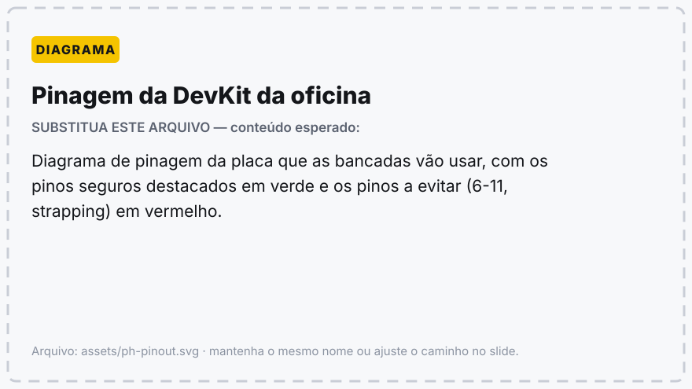

---
# ---------------------------------------------------------------
# TEMPLATE BASE DAS OFICINAS DO PETECO
# Copie este arquivo, renomeie e troque o conteúdo.
#   cp 00-template.md 02-pwm-e-protocolos.md
# ---------------------------------------------------------------
marp: true
theme: peteco
paginate: true
lang: pt-BR
header: 'Oficina de XXXXX · 0N — Subtítulo'
footer: 'PETECO — PET Engenharia de Computação · UTFPR'
title: 'Oficina de XXXXX — 0N. Subtítulo'
author: 'PETECO — PET Engenharia de Computação, UTFPR'
description: 'Uma linha explicando do que trata este encontro.'
---

<!-- ===============================================================
     CAPA — use a classe `lead`
     `_class` com underline vale só para ESTE slide.
     Sem underline (`<!-- class: lead -->`) vale deste slide em diante.
     =============================================================== -->

<!-- _class: lead -->
<!-- _header: '' -->
<!-- _footer: '' -->
<!-- _paginate: false -->

# Título da oficina

## 0N — Subtítulo do encontro

### PETECO — PET Engenharia de Computação
### Universidade Tecnológica Federal do Paraná

<!--
Este comentário vira NOTA DO APRESENTADOR: aparece no modo presenter
e na exportação para PPTX, mas não no slide. Use para lembretes de
tempo, perguntas para a turma e o que deixar montado antes de começar.
-->

---

<!-- ===============================================================
     DIVISÓRIA DE BLOCO — classe `section`
     Fundo amarelo. Use uma antes de cada parte da aula.
     =============================================================== -->

<!-- _class: section -->

#### Bloco 1

# Nome do bloco

## Uma frase dizendo o que a pessoa vai saber ao fim dele

---

<!-- ===============================================================
     SLIDE PADRÃO — título + lista
     =============================================================== -->

## Slide comum

Um parágrafo de abertura, quando o assunto precisa de contexto.

- Item de lista; o marcador sai em amarelo
- Use **negrito** para o termo que importa
- Sublistas ficam menores e em cinza:
  - detalhe secundário
  - outro detalhe

> Citação vira **caixa de recado**: bom para a regra prática, o aviso ou o resumo do slide.

---

<!-- ===============================================================
     CÓDIGO — o bloco já sai com fundo escuro e barra amarela
     =============================================================== -->

## Slide com código

```cpp
void setup() {
  Serial.begin(115200);
}

void loop() {
  Serial.println("olá");
  delay(1000);
}
```

Comente o código **abaixo** dele, em uma ou duas frases. Se o trecho passar de
umas 16 linhas, quebre em dois slides ou acrescente `<!-- _class: tight -->`.

---

<!-- ===============================================================
     TABELA
     =============================================================== -->

## Slide com tabela

| Coluna | Coluna | Coluna |
|---|---|---|
| valor | valor | valor |
| valor | valor | valor |

> Tabela com mais de 8 linhas costuma estourar o slide: use `tight` ou divida.

---

<!-- ===============================================================
     DUAS COLUNAS
     Precisa das linhas em branco dentro das <div>, senão o markdown
     de dentro não é interpretado.
     Variantes: class="cols" (1:1), "cols-1-2", "cols-2-1"
     =============================================================== -->

## Slide em duas colunas

<div class="cols"><div>

#### Esquerda

- primeiro ponto
- segundo ponto

</div><div>

#### Direita

- primeiro ponto
- segundo ponto

</div></div>

---

<!-- ===============================================================
     ATENÇÃO / ARMADILHA — classe `alert`
     =============================================================== -->

<!-- _class: alert -->

## Armadilha

Use este slide para o erro que a turma vai cometer se ninguém avisar.

- o que acontece
- por que acontece
- o que fazer no lugar

---

<!-- ===============================================================
     FUNDO ESCURO — classe `dark`
     Bom para fechar um bloco ou destacar um conceito.
     =============================================================== -->

<!-- _class: dark -->

## Slide escuro

#### Subtítulo em amarelo

Texto de destaque. Os **negritos** saem em amarelo aqui.

---

<!-- ===============================================================
     IMAGEM
     Dimensione com w: / h: dentro do alt. Ex.: 
     `bg` transforma a imagem em fundo do slide:
        
     Para imagens locais na exportação:  marp --allow-local-files
     =============================================================== -->

## Slide com imagem



<p class="legenda">Legenda opcional, em cinza e centralizada.</p>

---

<!-- ===============================================================
     SLIDE CENTRALIZADO — classe `center`
     =============================================================== -->

<!-- _class: center -->

## Pergunta para a turma

Uma frase só, grande, para abrir discussão.

---

<!-- ===============================================================
     MUITO CONTEÚDO — classe `tight`
     Reduz a fonte do slide inteiro. Combine com outras classes:
     <!-- _class: dark tight -->
     =============================================================== -->

<!-- _class: tight -->

## Slide denso

Quando não der para cortar, use `tight`. Mas prefira cortar.

---

## Prática

**Parte A.** O que montar.

**Parte B.** O que medir.

**Parte C.** O que precisa estar funcionando ao fim.

---

## Na próxima oficina

#### 0N+1 — Título do próximo encontro

- tópico
- tópico
- tópico

---

<!-- ===============================================================
     ENCERRAMENTO — classe `end`
     =============================================================== -->

<!-- _class: end -->
<!-- _header: '' -->
<!-- _footer: '' -->

# Obrigado!

## Dúvidas, agora ou depois

[utfpr.curitiba.br/peteco](https://utfpr.curitiba.br/peteco/) · [@peteco_utfpr](https://www.instagram.com/peteco_utfpr/) · [YouTube](https://www.youtube.com/c/PETECOUTFPR)

**PETECO — PET Engenharia de Computação, UTFPR**
