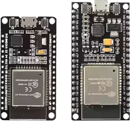
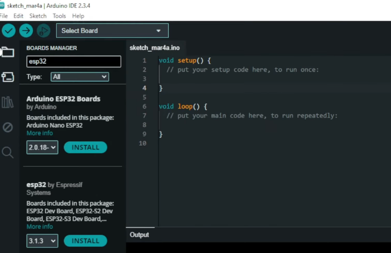
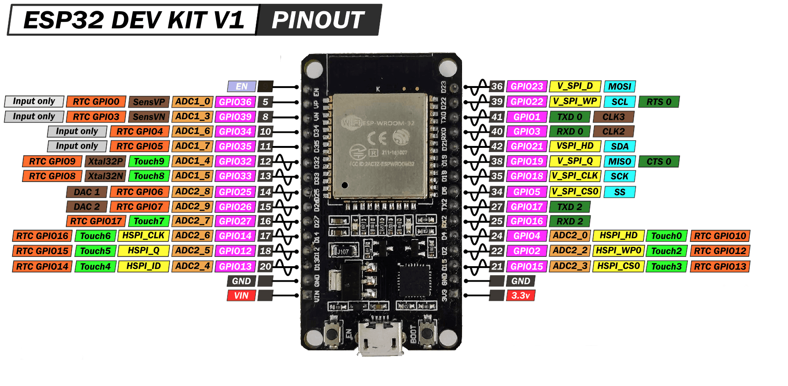
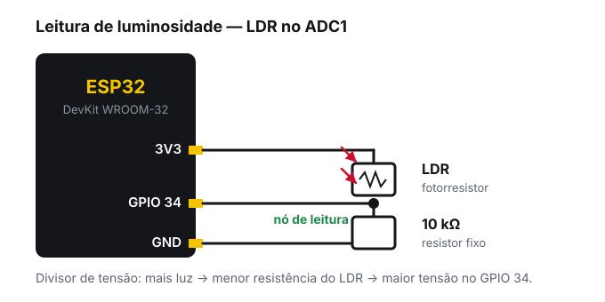
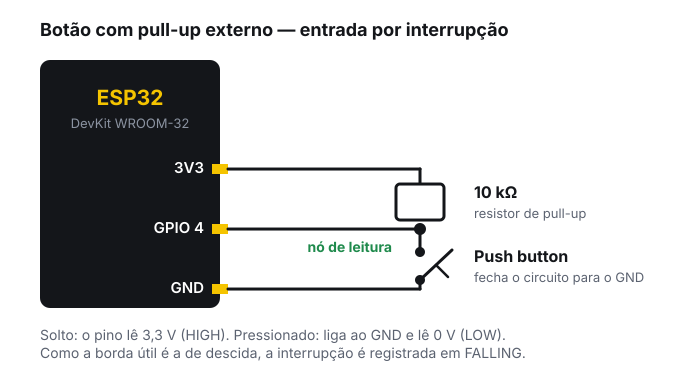

<!-- _class: lead -->
<!-- _header: '' -->
<!-- _footer: '' -->
<!-- _paginate: false -->

# Oficina de ESP32

## 01 — Fundamentos: da placa ao primeiro sensor

### PETECO — PET Engenharia de Computação
### Universidade Tecnológica Federal do Paraná


---

<!-- _class: center -->

## Antes de começar

Se você ainda não instalou nada, tudo bem — vamos instalar juntos.

Se já instalou, **abra a Arduino IDE agora** e confirme que a placa aparece na lista de portas.

> **Bancadas de 2 a 3 pessoas.** Cada bancada recebe uma ESP32, um cabo USB e uma protoboard. Quem trouxe notebook, conecte; quem não trouxe, divida com a dupla.

---

<!-- _class: section -->

#### Bloco 1

# Por que ESP32?

## O que ele resolve que o Arduino UNO não resolve

---

## O ponto de partida

O Arduino UNO dá conta de ler sensores e acionar atuadores. Ele começa a atrapalhar quando o projeto precisa de:

- **Conectividade** — mandar dado para um celular, para um painel web ou para outra placa
- **Processamento** — filtrar sinal, guardar histórico, rodar duas coisas ao mesmo tempo
- **Memória** — 2 KB de RAM acabam rápido quando entra um buffer ou uma string
- **Autonomia** — dormir de verdade entre leituras para durar em bateria

O ESP32 resolve os quatro sem módulo externo.

---

<!-- _class: tight -->

## Lado a lado

| | Arduino UNO | ESP32 (WROOM-32) |
|---|---|---|
| Núcleo | AVR 8 bits, 16 MHz | Xtensa LX6 32 bits, 2 núcleos, até 240 MHz |
| RAM | 2 KB | 520 KB |
| Tensão de I/O | 5 V | **3,3 V** |
| ADC | 10 bits (0–1023) | 12 bits (0–4095) |
| Wi-Fi / Bluetooth | não tem | Wi-Fi 802.11 b/g/n + BT Classic + BLE |
| PWM | 6 saídas | 16 canais configuráveis |
| Sistema operacional | nenhum | FreeRTOS embarcado |

> **A tensão é a diferença que mais machuca.**

---

## E o que você já sabe continua valendo

O core Arduino para ESP32 mantém a mesma API de sempre:

```cpp
void setup() {
  pinMode(LED, OUTPUT);
  Serial.begin(115200);
}

void loop() {
  digitalWrite(LED, HIGH);
  delay(500);
}
```

`pinMode`, `digitalWrite`, `analogRead`, `Serial`, `Wire`, `SPI` — tudo funciona. O que muda são os **detalhes de hardware** e os **recursos extras**. É neles que a oficina foca.

---

<!-- _class: section -->

#### Bloco 2

# A família ESP32

## Qual chip está na sua mão, e qual você deveria comprar

---

<!-- _class: tight -->

## Os modelos que você vai encontrar

| Modelo | Núcleo | Rádio | Boa para |
|---|---|---|---|
| **ESP32** (clássico) | Xtensa, 2 núcleos | Wi-Fi + BT Classic + BLE | O padrão. É o que temos aqui |
| **ESP32-S2** | Xtensa, 1 núcleo | só Wi-Fi | USB nativo, sem Bluetooth |
| **ESP32-S3** | Xtensa, 2 núcleos | Wi-Fi + BLE 5 | Câmera, áudio, ML na borda |
| **ESP32-C3** | RISC-V, 1 núcleo | Wi-Fi + BLE 5 | Projeto barato e enxuto |
| **ESP32-C6** | RISC-V | Wi-Fi 6 + BLE + Zigbee/Thread | Automação residencial |
| **ESP32-H2** | RISC-V | **sem Wi-Fi**, Zigbee/Thread | Rede de malha de baixo consumo |
| **ESP32-P4** | RISC-V | **sem rádio** | Processamento puro, vídeo |

> Precisa de Bluetooth **Classic** (áudio, SPP)? Só o ESP32 clássico atende — os demais têm apenas BLE.

---

## Placas, não chips

O chip vem embalado em módulos e placas. As que mais aparecem:

<div class="cols-1-2"><div>

- **DevKit V1 / DevKitC** — a da bancada, em versão de **30** ou **38 pinos**
- **ESP32-CAM** — câmera e cartão, mas **sem USB**: precisa de adaptador serial
- **XIAO ESP32** — minúscula, boa para vestível
- **T-Display / TTGO** — já vem com display

</div><div>



</div></div>

---

<!-- _class: alert -->

## Detalhe prático de montagem

A DevKit de **38 pinos** é larga: colocada numa protoboard de 830 pontos, ela cobre quase todos os furos e sobra **uma fileira de cada lado**.

Três saídas:

1. Usar **duas protoboards** encostadas lado a lado
2. Preferir a versão de **30 pinos** nas próximas compras
3. Usar jumpers **macho-fêmea** ligando direto nos pinos da placa

> Vale decidir isso **antes** de projetar a montagem final do protótipo de vocês.

---

<!-- _class: section -->

#### Bloco 3

# Ambiente de desenvolvimento

## Instalar, compilar, gravar — e o que fazer quando não grava

---

<!-- _class: tight -->

## Instalação em três passos

**1. Driver USB-serial.** Descubra o chip da sua placa e instale o driver correspondente:

- **CH340 / CH9102** — o mais comum nas placas genéricas
- **CP2102** — comum nas placas da própria Espressif

**2. Core ESP32 na Arduino IDE.** Em *Arquivo → Preferências → URLs adicionais para Gerenciadores de Placas*:

```text
https://espressif.github.io/arduino-esp32/package_esp32_index.json
```

Depois, em *Ferramentas → Placa → Gerenciador de Placas*, busque por `esp32` e instale **esp32 by Espressif Systems**, versão **3.x**.

**3. Selecionar a placa.** *Ferramentas → Placa → ESP32 Arduino → ESP32 Dev Module*. Porta: a que aparece ao conectar o cabo.

---

## Confirmando a instalação



> **Atenção à versão.** Boa parte dos tutoriais foi escrita para o core **2.x**, e algumas funções mudaram de nome no **3.x**. Isso aparece na oficina 2, em PWM e timers.

---

<!-- _class: tight -->

## Quando não grava: a lista de checagem

| Sintoma | Causa provável | O que fazer |
|---|---|---|
| Nenhuma porta aparece | Cabo **só de carga** | Trocar por um cabo de dados |
| Nenhuma porta aparece | Driver ausente | Instalar CH340 ou CP2102 |
| `Failed to connect ... Timed out waiting for packet header` | Placa não entrou em modo de gravação | Segurar **BOOT** enquanto aparece `Connecting...`, soltar quando começar a gravar |
| Grava, mas o monitor mostra lixo | Baud rate errado | Ajustar o monitor para **115200** |
| Reinicia sozinho em loop | Alimentação insuficiente | Trocar a porta USB ou usar fonte externa |
| `A fatal error occurred: ...` no meio | Velocidade alta demais | Reduzir *Upload Speed* para 115200 |

> Se a placa reinicia só quando o Wi-Fi liga, quase sempre é corrente: o rádio puxa picos que uma porta USB fraca não entrega.

---

## Primeiro sketch

```cpp
void setup() {
  Serial.begin(115200);
  delay(1000);                        // dá tempo para o monitor abrir
  Serial.println("ESP32 vivo!");
  Serial.printf("Núcleos: %d | Frequência: %d MHz\n",
                ESP.getChipCores(), getCpuFrequencyMhz());
  Serial.printf("RAM livre: %d bytes\n", ESP.getFreeHeap());
}

void loop() {
  delay(1000);
}
```

**Faça agora** (`exemplos/01a-primeiro-sketch`). Apareceu no monitor? Bancada pronta.

---

<!-- _class: section -->

#### Bloco 4

# GPIO: as armadilhas

## O bloco que evita a maior parte da dor de cabeça no projeto

---

<!-- _class: alert -->

## Armadilha 1 — a placa é 3,3 V

Todos os pinos do ESP32 trabalham em **3,3 V**. Não são tolerantes a 5 V.

- Ligar uma saída de 5 V direto num GPIO pode **queimar o pino ou o chip**
- Sensores e módulos de 5 V precisam de **divisor de tensão** ou **conversor de nível**
- O pino `VIN` aceita 5 V (é a entrada do regulador), mas `3V3` **não**

Corrente por pino: o limite absoluto é de cerca de **40 mA**, e o valor recomendado de projeto é **20 mA**. Motor, relé e fita de LED vão em driver, nunca direto no GPIO.

---

<!-- _class: tight -->

## Armadilha 2 — nem todo pino faz tudo

**GPIO 34, 35, 36, 37, 38, 39 são somente de entrada.**

- Não funcionam como saída: `digitalWrite` neles simplesmente não faz nada
- Não têm resistor de pull-up nem de pull-down interno, então `INPUT_PULLUP` não tem efeito
- Se quiser um botão nesses pinos, o pull-up precisa ser **externo**

**GPIO 6, 7, 8, 9, 10 e 11 estão ligados à memória flash.**

- Usá-los trava a placa — em geral, nem chegam expostos na DevKit
- Se estiverem expostos, considere que não existem

> Erro clássico: ligar o LED no GPIO 34 e passar meia hora procurando bug no código.

---

<!-- _class: tight -->

## Armadilha 3 — strapping pins

No instante do boot, o ESP32 lê o nível de alguns pinos para decidir como iniciar. Se o seu circuito segurar esses pinos no nível errado, **a placa não liga ou entra em modo de gravação**.

| Pino | Papel no boot | Cuidado |
|---|---|---|
| **GPIO 0** | Escolhe boot normal x gravação | Em LOW no boot, entra em modo de gravação |
| **GPIO 2** | Precisa ficar livre ou em LOW no boot | É o LED da placa em muitos modelos |
| **GPIO 5** | Sai em HIGH durante o boot | Evite para algo que não pode receber pulso |
| **GPIO 12** | Define a tensão da flash | Em HIGH no boot, pode **impedir a inicialização** |
| **GPIO 15** | Controla o log de boot | Em LOW, silencia o log inicial |

> Use esses pinos por último. Se precisar deles, teste o boot com o circuito **completo** ligado.

---

## Os pinos seguros

Para uso geral, sem surpresa:

<div class="cols"><div>

#### Entrada e saída
`13` · `14` · `16` · `17` · `18` · `19`
`21` · `22` · `23` · `25` · `26` · `27`
`32` · `33`

</div><div>

#### Somente entrada
`34` · `35` · `36` · `39`

</div></div>


---

<!-- _class: center -->



---

<!-- _class: section -->

#### Bloco 5

# Leitura analógica

## O ADC do ESP32 e o primeiro sensor

---

<!-- _class: alert -->

## O ADC tem dois blocos, e só um convive com o Wi-Fi

| | Pinos | Wi-Fi ligado |
|---|---|---|
| **ADC1** | GPIO 32 a 39 | funciona normalmente |
| **ADC2** | GPIO 0, 2, 4, 12–15, 25–27 | **deixa de funcionar** |

O rádio Wi-Fi toma o ADC2 para si. Com o Wi-Fi ativo, `analogRead` num pino do ADC2 devolve lixo ou trava.

> **Regra para o projeto de vocês:** todo sensor analógico vai num pino do **ADC1** (32 a 39). Sempre. Mesmo que hoje o projeto ainda não use Wi-Fi.

---

<!-- _class: tight -->

## Lendo um valor analógico

```cpp
const int PINO_LDR = 34;          // ADC1, somente entrada — perfeito para sensor

void setup() {
  Serial.begin(115200);
  analogReadResolution(12);       // padrão, mas deixa explícito
}

void loop() {
  int bruto = analogRead(PINO_LDR);
  int mv    = analogReadMilliVolts(PINO_LDR);   // já calibrado de fábrica
  Serial.printf("bruto=%4d  tensao=%4d mV\n", bruto, mv);
  delay(200);
}
```

O ADC é de **12 bits**: a leitura vai de `0` a `4095`. Ele **não é linear** nas pontas da faixa — por isso, para comparar com um limiar físico, use `analogReadMilliVolts`, que aplica a calibração de fábrica. Para um valor relativo, o bruto basta.

---

## A prática: LDR no divisor de tensão



A resistência do LDR cai quando a luz aumenta. Em série com o resistor fixo, isso vira uma tensão que o ADC lê.

---

<!-- _class: section -->

#### Bloco 6

# Tempo e interrupções

## Como parar de travar o programa

---

<!-- _class: tight -->

## `delay()` é dívida técnica

```cpp
void loop() {
  digitalWrite(LED, HIGH);
  delay(1000);            // 1 segundo em que NADA mais acontece
  digitalWrite(LED, LOW);
  delay(1000);            // o botão pode ser pressionado aqui e ninguém vê
}
```

Enquanto o `delay()` roda, o programa não lê sensor, não atende botão, não responde à rede. Num projeto com mais de uma coisa acontecendo, isso quebra.

---

<!-- _class: tight -->

## O padrão `millis()`

```cpp
unsigned long ultimoPisca = 0;
const unsigned long INTERVALO = 1000;

void loop() {
  unsigned long agora = millis();
  if (agora - ultimoPisca >= INTERVALO) {
    ultimoPisca = agora;
    digitalWrite(LED, !digitalRead(LED));
  }
  // o loop continua girando: dá para ler sensor, checar rede, atender botão
}
```

> Escreva `agora - ultimoPisca >= INTERVALO`, nunca `agora >= ultimoPisca + INTERVALO`. A primeira forma sobrevive ao estouro do contador; a segunda não.

---

<!-- _class: tight -->

## Interrupção: o hardware avisa você

Em vez de perguntar o tempo todo se o botão foi pressionado, você registra uma função que o hardware chama **no instante** em que o pino muda.

```cpp
const int PINO_BOTAO = 4;
volatile bool apertou = false;

void IRAM_ATTR aoApertar() {         // esta é a ISR
  apertou = true;
}

void setup() {
  pinMode(PINO_BOTAO, INPUT_PULLUP);
  attachInterrupt(digitalPinToInterrupt(PINO_BOTAO), aoApertar, FALLING);
}
```

No ESP32, **qualquer GPIO** aceita interrupção. Modos: `RISING`, `FALLING`, `CHANGE`, `ONLOW`, `ONHIGH`.

---

<!-- _class: dark -->

## As duas palavras que não podem faltar

#### `volatile`

Toda variável compartilhada entre a ISR e o `loop()` precisa ser `volatile`. Sem isso o compilador pode guardar a variável num registrador e **otimizar fora** a leitura — o `loop()` nunca vê a mudança.

#### `IRAM_ATTR`

Coloca a função na memória RAM interna, em vez da flash. Garante que a ISR possa executar mesmo quando a flash está ocupada. **Sem isso o programa pode travar de forma aleatória** — e é o tipo de bug que só aparece na apresentação para a banca.

---

<!-- _class: alert -->

## Dentro de uma ISR, não faça

- **`Serial.print`** — usa buffer e interrupção; trava a placa
- **`delay()`** — a ISR precisa acabar em microssegundos
- **`malloc`, `new`, `String`** — alocação dinâmica não é segura ali dentro
- **Laço longo, cálculo pesado, acesso a rede** — nada disso
- **Chamar outra função que faça qualquer uma das coisas acima**

**O que fazer:** levante uma flag `volatile` e saia. O trabalho de verdade acontece no `loop()`.

> Na oficina 3 veremos a forma robusta disso: a ISR envia o dado para uma fila do FreeRTOS e uma *task* separada processa.

---

<!-- _class: tight -->

## O padrão completo, com debounce

```cpp
void loop() {
  if (apertou) {                  // a ISR avisou: agora o loop trabalha
    ledAceso = !ledAceso;
    digitalWrite(PINO_LED, ledAceso);
    Serial.println(ledAceso ? "LED aceso" : "LED apagado");

    delay(200);                   // espera o contato parar de repicar
    apertou = false;              // descarta as bordas do repique
  }
}
```

A ISR só levanta a flag. Quem imprime, acende o LED e trata o repique é o `loop()`.

---

## Por que o debounce é obrigatório

O contato metálico do botão **repica**: em poucos milissegundos ele abre e fecha várias vezes. Sem tratamento, um toque vira cinco interrupções.



> Com `INPUT_PULLUP` interno, o resistor externo do desenho é dispensável — exceto nos GPIOs 34 a 39, que não têm pull-up.

---

<!-- _class: section -->

#### Prática

# Mãos na bancada

## Dois circuitos, um de cada vez

---

<!-- _class: tight -->

## Circuito 1 — leitura analógica com LDR

Código: `exemplos/01b-ldr-led`

1. Monte o divisor de tensão com o LDR no **GPIO 34** (ADC1)
2. Grave o sketch e abra o **Serial Plotter**. Cubra o sensor com a mão e veja a curva cair
3. Anote o valor no claro e no escuro, e ajuste `LIMIAR_ESCURO` para um valor entre os dois
4. Ligue o LED no **GPIO 13** e confira: ele acende quando escurece

> **Teste a armadilha:** mude o LED para o GPIO 34 e veja que nada acontece. É um pino somente de entrada.

---

<!-- _class: tight -->

## Circuito 2 — botão por interrupção

Código: `exemplos/01c-botao-interrupcao`

Desmonte o circuito anterior e comece do zero.

1. Ligue o botão entre o **GPIO 4** e o **GND** — o `INPUT_PULLUP` dispensa o resistor
2. Ligue o LED no **GPIO 13**
3. Grave e confira: cada aperto liga ou desliga o LED

> **Veja o repique:** comente a linha do `delay(200)` e aperte o botão algumas vezes. Um aperto vai virar várias trocas no monitor serial.

---

<!-- _class: dark -->

## Para levar para o projeto

- **Escolha os pinos primeiro.** Desenhe o mapa de pinos do projeto antes de soldar qualquer coisa: sensor analógico no ADC1, nada nos GPIOs 6–11, cuidado com os strapping
- **Nada de 5 V nos GPIOs.** Se o módulo é de 5 V, resolva o nível lógico agora, não depois
- **Meça o seu sensor.** Limiar se escolhe olhando a leitura real na bancada, não copiando de tutorial
- **Interrupção para evento, `loop()` para trabalho.** Serve para botão, encoder, sensor de pulso e fim de curso

---

<!-- _class: tight -->

## Referências

| O quê | Onde |
|---|---|
| Documentação oficial do core Arduino | `docs.espressif.com/projects/arduino-esp32/en/latest/` |
| Instalação (Windows, Linux, macOS) | `.../installing.html` |
| Migração da versão 2.x para 3.x | `.../migration_guides/2.x_to_3.0.html` |
| Referência de pinagem | `randomnerdtutorials.com/esp32-pinout-reference-gpios/` |
| Exemplos oficiais de cada biblioteca | `github.com/espressif/arduino-esp32` |
| Código desta oficina | `[LINK DO REPOSITÓRIO]` |

---

## Na próxima oficina

#### 02 — PWM e protocolos de comunicação

- **PWM por LEDC** — brilho, buzzer e servo, com a API nova do core 3.x
- **Timers de hardware** — amostrar um sensor em taxa fixa, sem depender do `loop()`
- **I2C** — endereços, pull-ups e o scanner que salva o seu debug
- **SPI, UART e 1-Wire** — quando usar cada um
- **Prática** — display OLED mostrando a leitura de um sensor I2C

---

<!-- _class: end -->
<!-- _header: '' -->
<!-- _footer: '' -->

# Obrigado!

## Dúvidas, agora ou depois

[utfpr.curitiba.br/peteco](https://utfpr.curitiba.br/peteco/) · [@peteco_utfpr](https://www.instagram.com/peteco_utfpr/) · [YouTube](https://www.youtube.com/c/PETECOUTFPR)

**PETECO — PET Engenharia de Computação, UTFPR**
