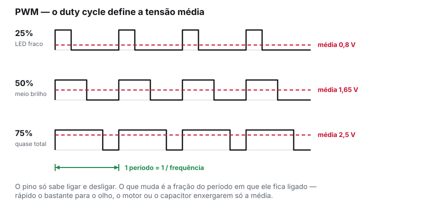
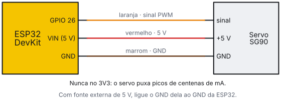
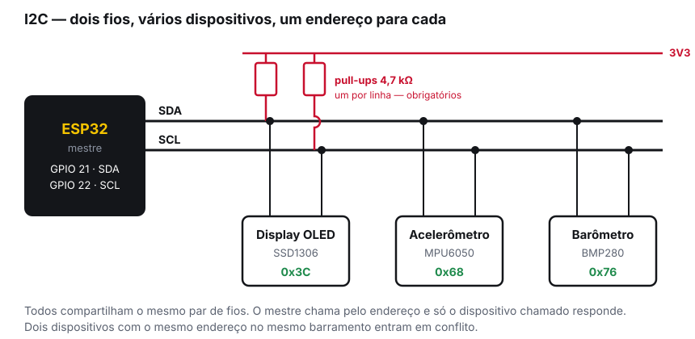
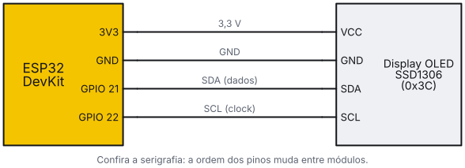
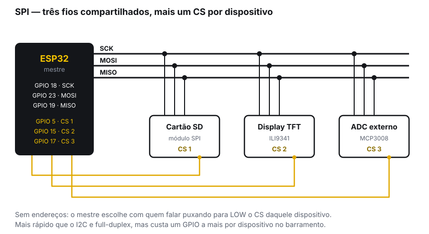
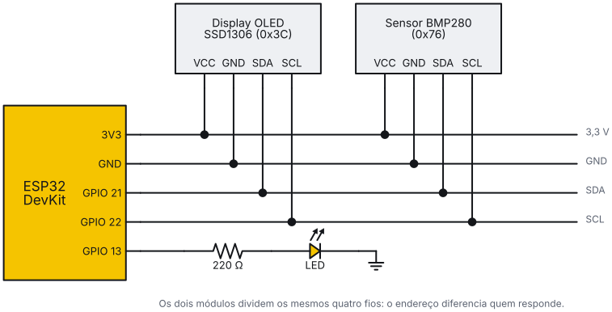

<!-- _class: lead -->
<!-- _header: '' -->
<!-- _footer: '' -->
<!-- _paginate: false -->

# Oficina de ESP32

## 02 — PWM e protocolos de comunicação

### PETECO — PET Engenharia de Computação
### Universidade Tecnológica Federal do Paraná


---

<!-- _class: center -->

## Onde paramos

Na oficina 1: pinagem, ADC, `millis()` e interrupções.

Hoje o ESP32 deixa de só **ler** o mundo e passa a **agir** sobre ele — e a conversar com os sensores de verdade do projeto de vocês.

> Quem não esteve na oficina 1: o código está no repositório, e o que importa para hoje é só uma coisa — **sensor analógico vai no ADC1 (GPIO 32 a 39)**.

---

<!-- _class: section -->

#### Bloco 1

# PWM

## Controlar intensidade com um pino que só sabe ligar e desligar

---

## O problema

Um GPIO entrega 0 V ou 3,3 V. Não existe meio termo.

Mas o projeto precisa de **meio brilho**, **meia velocidade**, **um ângulo específico**.

A saída é ligar e desligar muito rápido, variando a fração de tempo ligado. Isso é **PWM** — *Pulse Width Modulation*.

> O LED, o motor e o ouvido humano não acompanham a chaveamento: eles respondem à **média**.

---

## Duty cycle



---

<!-- _class: tight -->

## No ESP32 o PWM se chama LEDC

O periférico é o **LEDC** (*LED Control*). Apesar do nome, serve para qualquer saída PWM.

**16 canais** independentes, resolução de **1 a 20 bits** e frequência configurável.

```cpp
const int PINO_LED = 13;

void setup() {
  ledcAttach(PINO_LED, 5000, 8);   // pino, 5 kHz, 8 bits (0 a 255)
}

void loop() {
  for (int d = 0; d <= 255; d++) { ledcWrite(PINO_LED, d); delay(4); }
  for (int d = 255; d >= 0; d--) { ledcWrite(PINO_LED, d); delay(4); }
}
```

> No core 3.x você fala com o **pino**, não com o canal: a atribuição é automática.

---

<!-- _class: alert -->

## Atenção: a API mudou no core 3.x

Quase todo tutorial de ESP32 que você achar no Google usa a API antiga. Ela **não compila** no core 3.x.

| Core 2.x (não use) | Core 3.x (atual) |
|---|---|
| `ledcSetup(canal, freq, res)` | `ledcAttach(pino, freq, res)` |
| `ledcAttachPin(pino, canal)` | *(junto no `ledcAttach`)* |
| `ledcWrite(canal, duty)` | `ledcWrite(pino, duty)` |
| `ledcDetachPin(pino)` | `ledcDetach(pino)` |

> Se aparecer `'ledcSetup' was not declared in this scope`, é isso. O tutorial é velho, não o seu código.

---

<!-- _class: tight -->

## Frequência e resolução não são independentes

Os dois saem do mesmo clock de 80 MHz, então a frequência máxima é `80 MHz / 2^bits`:

| Resolução | Valores de duty | Frequência máxima |
|---|---|---|
| 8 bits | 0 a 255 | ~312 kHz |
| 10 bits | 0 a 1023 | ~78 kHz |
| 12 bits | 0 a 4095 | ~19,5 kHz |
| 16 bits | 0 a 65535 | ~1,2 kHz |

- **LED**: 5 kHz e 8 bits. Acima de ~200 Hz o olho não vê cintilação
- **Motor DC**: 20 kHz e 8 bits — acima da faixa audível, para não apitar
- **Servo**: 50 Hz e 16 bits, porque o controle é por largura de pulso fina

---

<!-- _class: tight -->

## Buzzer: PWM virando som

Com um **buzzer passivo**, a frequência do PWM *é* a nota.

```cpp
const int PINO_BUZZER = 25;

void setup() {
  ledcAttach(PINO_BUZZER, 2000, 8);
}

void beep(uint32_t freq, uint32_t ms) {
  ledcWriteTone(PINO_BUZZER, freq);   // liga o tom
  delay(ms);
  ledcWriteTone(PINO_BUZZER, 0);      // silencia
}
```

> Compre o **passivo**: o ativo apita sozinho numa nota fixa e ignora `ledcWriteTone`.

---

<!-- _class: tight -->

## Servo: PWM virando ângulo

O servo lê a **largura do pulso** dentro de um período de 20 ms (50 Hz). A biblioteca **ESP32Servo** (Library Manager) resolve a conversão.

```cpp
#include <ESP32Servo.h>

Servo meuServo;
const int PINO_SERVO = 26;

void setup() {
  ESP32PWM::allocateTimer(0);              // reserva um timer
  meuServo.setPeriodHertz(50);             // servo analógico: 50 Hz
  meuServo.attach(PINO_SERVO, 500, 2400);  // pino, pulso mín/máx em µs
}

void loop() {
  meuServo.write(0);    delay(1000);       // ângulo em graus
  meuServo.write(180);  delay(1000);
}
```

---

<!-- _class: alert -->

## O servo não se alimenta pelo pino de 3,3 V

Um SG90 puxa picos de várias centenas de miliampères ao se mover. O regulador de 3,3 V da DevKit não entrega isso.

- **Sinal** (laranja ou amarelo) → GPIO
- **Alimentação** (vermelho) → **5 V** (`VIN`) ou fonte externa
- **Terra** (marrom ou preto) → GND, e o GND da fonte externa precisa ser **comum** com o do ESP32

> Sintoma clássico: a placa reinicia toda vez que o servo se move. É queda de tensão, não bug de software.

---

<!-- _class: center -->

## Ligação do servo



---

<!-- _class: section -->

#### Bloco 2

# Timers de hardware

## Fazer algo em intervalo exato, sem depender do `loop()`

---

<!-- _class: tight -->

## Por que não basta `millis()`

O padrão `millis()` da oficina 1 resolve a maior parte dos casos, mas ele depende do `loop()` passar ali. Se outra parte do código demorar, a amostragem atrasa junto.

Quando o intervalo precisa ser **exato** — amostrar um sinal, gerar uma base de tempo, contar pulsos — use um **timer de hardware**. Ele conta sozinho, no periférico, e dispara a interrupção na hora certa.

```cpp
hw_timer_t *timer = NULL;
volatile uint32_t ticks = 0;

void IRAM_ATTR aoEstourarTimer() { ticks++; }

void setup() {
  Serial.begin(115200);
  timer = timerBegin(1000000);                  // base de 1 MHz: 1 tick = 1 µs
  timerAttachInterrupt(timer, &aoEstourarTimer);
  timerAlarm(timer, 100000, true, 0);           // dispara a cada 100.000 µs = 100 ms
}
```

---

<!-- _class: tight -->

## Entendendo os parâmetros

```cpp
timer = timerBegin(1000000);            // frequência do CONTADOR, em Hz
timerAlarm(timer, 100000, true, 0);     // valor do alarme, autoreload, repetições
```

- **`timerBegin(frequência)`** — a que velocidade o contador anda. Com 1 MHz, cada tique é 1 µs. É a sua unidade de tempo
- **`timerAlarm(timer, valor, autoreload, contagem)`** — dispara a interrupção quando o contador chega em `valor`. Com `autoreload = true`, recomeça sozinho. `contagem = 0` significa repetir para sempre

Então o período é `valor / frequência`. No exemplo: 100000 / 1000000 = **0,1 s**.

> Também mudou no 3.x: antes era `timerBegin(num, divisor, contaPraCima)` seguido de `timerAlarmWrite` e `timerAlarmEnable`. Agora são duas chamadas.

---

<!-- _class: dark -->

## A ISR do timer segue as mesmas regras

Tudo o que valia na oficina 1 continua valendo:

- **`IRAM_ATTR`** na função
- **`volatile`** nas variáveis compartilhadas
- **Nada de `Serial.print`, `delay` ou alocação** lá dentro
- Levante a flag, incremente o contador — e trate no `loop()`

> Na oficina 3 trocamos essa flag por uma **fila do FreeRTOS**, que é a forma robusta de passar o dado da interrupção para quem processa.

---

<!-- _class: section -->

#### Bloco 3

# Protocolos

## Como os sensores de verdade conversam com a placa

---

<!-- _class: tight -->

## Quatro formas de conversar

Até agora, todo sensor da oficina era um fio com uma tensão. Sensores reais — displays, acelerômetros, GPS, cartões — falam por protocolo.

| | Fios | Velocidade | Dispositivos | Típico em |
|---|---|---|---|---|
| **I2C** | 2 + alim. | ~100–400 kHz | muitos, por endereço | Display OLED, MPU6050, BMP280, RTC |
| **SPI** | 3 + 1 por disp. | dezenas de MHz | muitos, por CS | Cartão SD, display TFT, rádio |
| **UART** | 2 + alim. | configurável | **um por porta** | GPS, leitor RFID, módulos seriais |
| **1-Wire** | 1 + alim. | lenta | muitos, por ID | DS18B20 (temperatura) |

**A regra geral:** I2C quando há muitos sensores e pouca pressa. SPI quando o volume de dados é grande. UART quando o módulo só tem TX e RX.

---

<!-- _class: section -->

#### Bloco 3.1

# I2C

## O que você mais vai usar

---

## Dois fios para todo mundo



---

<!-- _class: center -->

## Ligando o display na bancada



---

<!-- _class: tight -->

## Ligando um dispositivo I2C

Quatro fios por módulo: **VCC**, **GND**, **SDA** e **SCL**.

```cpp
#include <Wire.h>

void setup() {
  Serial.begin(115200);
  Wire.begin();                 // usa os pinos padrão: SDA 21, SCL 22
  // Wire.begin(16, 17);        // ou escolha os seus
  // Wire.setClock(400000);     // modo rápido, se o dispositivo aceitar
}
```

- Os pinos padrão são **GPIO 21 (SDA)** e **GPIO 22 (SCL)**, mas quase qualquer GPIO serve
- O ESP32 tem **dois barramentos**: `Wire` e `Wire1`. Útil quando dois dispositivos têm o mesmo endereço fixo
- Módulos de breakout quase sempre **já trazem os pull-ups soldados**. Se você somar vários no mesmo barramento, os resistores ficam em paralelo e a resistência cai demais — aí vale remover alguns

---

<!-- _class: tight -->

## O scanner I2C: sua primeira ferramenta de debug

Antes de depurar biblioteca, descubra se o dispositivo sequer responde.

```cpp
#include <Wire.h>

void setup() {
  Serial.begin(115200);
  Wire.begin();

  for (uint8_t end = 1; end < 127; end++) {
    Wire.beginTransmission(end);
    if (Wire.endTransmission() == 0) {      // 0 = alguém respondeu
      Serial.printf("encontrado em 0x%02X\n", end);
    }
  }
}

void loop() {}
```

---

<!-- _class: alert tight -->

## Como ler o resultado do scanner

| O que apareceu | O que significa |
|---|---|
| O endereço esperado | Hardware OK. Qualquer erro daqui para frente é software |
| **Nenhum dispositivo** | Fio trocado, sem alimentação, SDA e SCL invertidos ou pull-up ausente |
| Endereço **diferente** do esperado | Variante do módulo. Passe o endereço achado para a biblioteca |
| **Todos** os 127 endereços | SDA em curto com o GND, ou sem pull-up nenhum |

> Rode o scanner **antes** de usar a biblioteca do sensor: ele separa problema de fio de problema de código, e isso economiza horas.

---

<!-- _class: tight -->

## O que o scanner responde

Saída do `exemplos/02a-scanner-i2c` no monitor serial, com o OLED e o BMP280 ligados:

```text
=== Scanner I2C ===
  dispositivo em 0x3C  (provavel display OLED SSD1306)
  dispositivo em 0x76  (provavel BMP280 / BME280)
  total: 2 dispositivo(s)
-------------------
```

Com um fio solto, sem alimentação ou com SDA e SCL trocados:

```text
  nenhum dispositivo encontrado
  confira: alimentacao, SDA/SCL trocados, pull-ups
-------------------
```

> A varredura se repete a cada 5 s: mexa nos fios e veja a lista mudar na hora.

---

<!-- _class: tight -->

## Usando o display OLED

Bibliotecas: **Adafruit SSD1306** + **Adafruit GFX** (ou **U8g2**, mais leve).

```cpp
Adafruit_SSD1306 display(128, 64, &Wire, -1);  // larg., alt., barramento, reset

void setup() {
  Wire.begin();
  if (!display.begin(SSD1306_SWITCHCAPVCC, 0x3C)) {  // endereço do scanner!
    while (true) delay(100);     // não achou: não adianta seguir
  }
  display.clearDisplay();
  display.setTextSize(2);
  display.setTextColor(SSD1306_WHITE);
  display.println("PETECO");
  display.display();             // sem esta linha, nada aparece
}
```

> `display.display()` é o passo que todo mundo esquece.

---

<!-- _class: section -->

#### Bloco 3.2

# SPI, UART e 1-Wire

## Quando o I2C não serve

---

## SPI: mais rápido, mais fios



---

<!-- _class: tight -->

## SPI na prática

Quatro linhas, e cada nome diz o que faz:

- **SCK** — clock, gerado pelo mestre
- **MOSI** — *Master Out, Slave In*: dados que saem do ESP32
- **MISO** — *Master In, Slave Out*: dados que voltam
- **CS** (ou SS) — *Chip Select*: um por dispositivo, ativo em LOW

---
## Os dois barramentos SPI

O ESP32 expõe **VSPI** (Virtual SPI, o padrão) e **HSPI** (Hardware SPI), cada um com seu conjunto de pinos:

| | VSPI (padrão) | HSPI |
|---|---|---|
| SCK | 18 | 14 |
| MOSI | 23 | 13 |
| MISO | 19 | 12 |
| CS | 5 | 15 |

---

## Os dois barramentos SPI

VSPI e HSPI possuem as mesmas funções, capacidades e funcionamento, sendo a diferença apenas uma nomenclatura para distinguir os pinos padrão de cada barramento.

> **I2C** quando houver vários sensores lentos e poucos pinos livres. **SPI** quando o volume de dados for grande: cartão SD, display colorido, rádio.

---

<!-- _class: tight -->

## UART: a serial de sempre, mas em três vias

O ESP32 tem **três UARTs**. A `Serial` (UART0) é a do monitor e da gravação: não a dispute.

```cpp
void setup() {
  Serial.begin(115200);                      // UART0: monitor serial
  Serial2.begin(9600, SERIAL_8N1, 16, 17);   // baud, formato, RX, TX
}

void loop() {
  while (Serial2.available()) Serial.write(Serial2.read());
}
```

- **RX do ESP32 vai no TX do módulo**, e vice-versa: trocar é o erro mais comum
- Os pinos são remapeáveis; módulo de 5 V no RX pede **divisor de tensão**

> Típico em GPS, leitor RFID e para falar com outro microcontrolador.

---

<!-- _class: tight -->

## 1-Wire: um fio só

O **DS18B20** mede temperatura por um fio só, com pull-up de 4,7 kΩ. Cada sensor tem um ID de fábrica, então vários convivem no mesmo fio.

```cpp
OneWire barramento(4);                 // GPIO 4
DallasTemperature sensores(&barramento);

void setup() { sensores.begin(); }

void loop() {
  sensores.requestTemperatures();
  Serial.printf("%.2f C\n", sensores.getTempCByIndex(0));
  delay(1000);
}
```

> Bibliotecas **OneWire** + **DallasTemperature**. Vem em versão à prova d'água.

---

<!-- _class: section -->

#### Prática

# Mãos na bancada

## Um sensor, um display e um atuador — a espinha de um projeto

---

<!-- _class: tight -->

## Roteiro da prática

**Parte A — descobrir.** Ligue o display OLED (VCC, GND, SDA 21, SCL 22) e rode o **scanner I2C**. Anote o endereço que aparecer. Só siga quando o scanner achar o dispositivo.

**Parte B — mostrar.** Escreva o nome da sua equipe no display. Lembre do `display.display()`.

**Parte C — medir.** Some o sensor I2C (MPU6050 ou BMP280) ao **mesmo** barramento — os mesmos dois fios. Rode o scanner de novo: agora devem aparecer dois endereços. Mostre a leitura do sensor no display, atualizando sem `delay()`.

**Parte D — agir.** Use a leitura para controlar um atuador por PWM:

- com o **BMP280**: a temperatura define o brilho do LED
- com o **MPU6050**: a inclinação define o ângulo do servo

**Desafio.** Troque o `millis()` da atualização do display por um **timer de hardware** a 10 Hz.

---

## Critério de pronto

Ao fim da oficina, sua bancada deve ter um sketch que:

1. Encontra os dois dispositivos no barramento I2C pelo scanner
2. Lê o sensor e mostra o valor no display, legível a um metro
3. Aciona um atuador por **PWM**, com a API do core 3.x
4. Roda sem nenhum `delay()` no `loop()`

---

<!-- _class: center -->

## A montagem completa



Passo a passo e problemas comuns: `exemplos/MONTAGEM.md`

---

<!-- _class: dark -->

## Para levar para o projeto

- **Compre sensores I2C.** Quase tudo que a equipe precisa existe em I2C, e cabe nos mesmos dois fios já usados pelo display
- **Rode o scanner antes de acusar a biblioteca.** Metade dos "o sensor não funciona" morre nesse slide
- **Confira a tensão do módulo.** Muito breakout é 5 V. No barramento I2C isso também vale para os pull-ups
- **Planeje a alimentação dos atuadores.** Servo e motor não saem do regulador da placa
- **Anote os endereços** dos seus dispositivos no mapa de pinos do projeto, junto dos GPIOs

---

<!-- _class: tight -->

## Referências

| O quê | Onde |
|---|---|
| API de LEDC (PWM) | `docs.espressif.com/projects/arduino-esp32/en/latest/api/ledc.html` |
| API de timers | `.../api/timer.html` |
| API de I2C (Wire) | `.../api/i2c.html` |
| Migração 2.x → 3.x | `.../migration_guides/2.x_to_3.0.html` |
| Biblioteca ESP32Servo | Library Manager → *ESP32Servo* |
| Adafruit SSD1306 e GFX | Library Manager → *Adafruit SSD1306* |
| Código desta oficina | `[LINK DO REPOSITÓRIO]` |

---

## Na próxima oficina

#### 03 — FreeRTOS, persistência e energia

- **FreeRTOS** — duas tarefas de verdade ao mesmo tempo, uma em cada núcleo
- **Filas e mutex** — passar dado da interrupção sem perder nada
- **Preferences e LittleFS** — salvar configuração e histórico na flash
- **Deep sleep** — fazer o protótipo durar em bateria

> É a oficina que mais muda a forma de organizar um programa embarcado.

---

<!-- _class: end -->
<!-- _header: '' -->
<!-- _footer: '' -->

# Obrigado!

## Dúvidas, agora ou depois

[utfpr.curitiba.br/peteco](https://utfpr.curitiba.br/peteco/) · [@peteco_utfpr](https://www.instagram.com/peteco_utfpr/) · [YouTube](https://www.youtube.com/c/PETECOUTFPR)

**PETECO — PET Engenharia de Computação, UTFPR**
