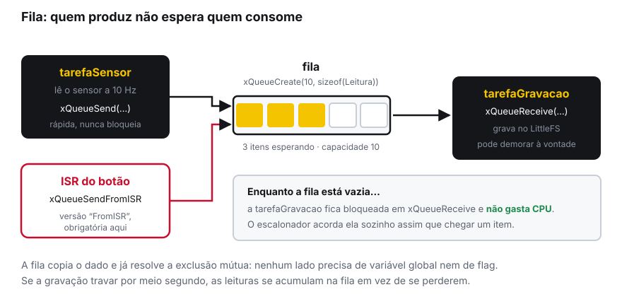
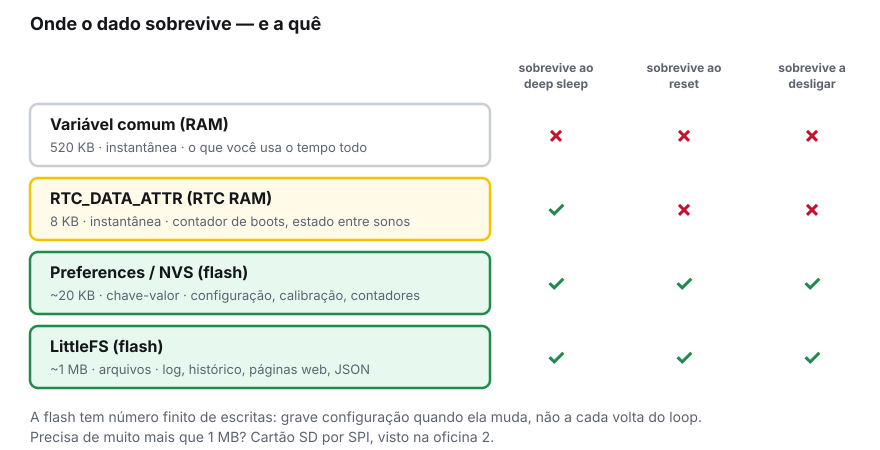
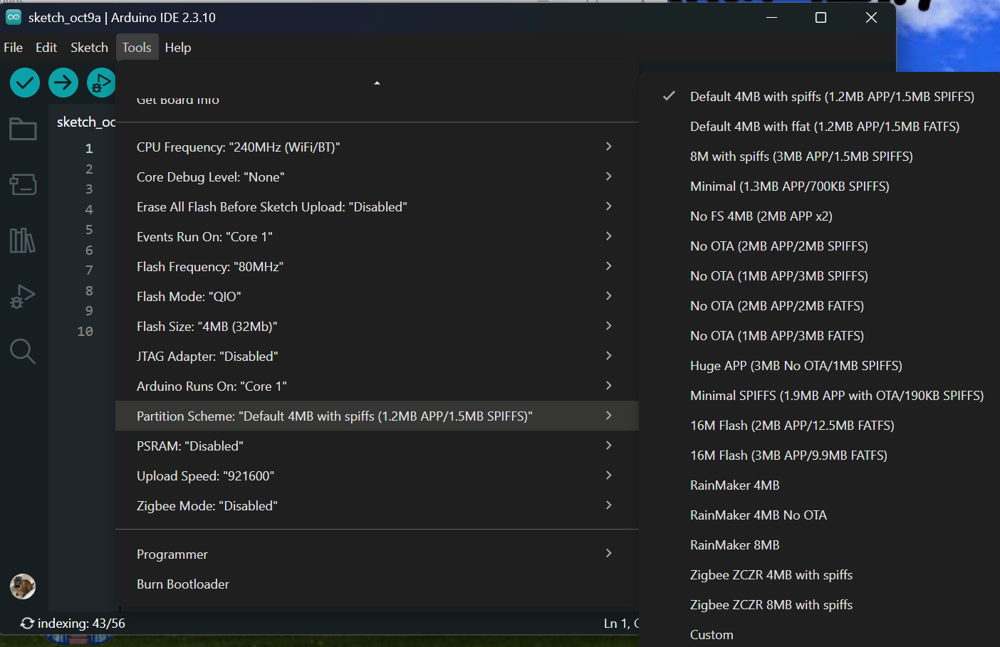
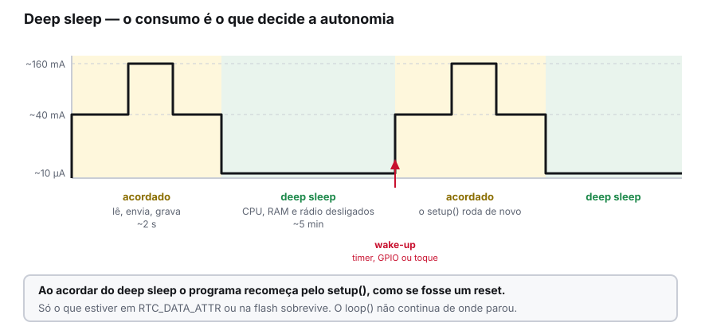
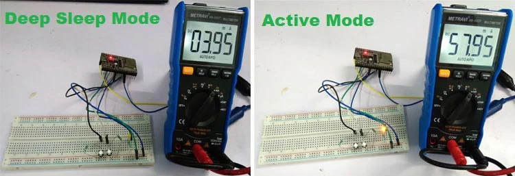
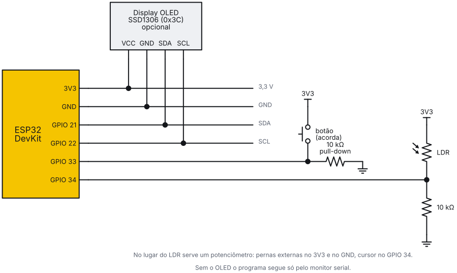

<!-- _class: lead -->
<!-- _header: '' -->
<!-- _footer: '' -->
<!-- _paginate: false -->

# Oficina de ESP32

## 03 — FreeRTOS, persistência e energia

### PETECO — PET Engenharia de Computação
### Universidade Tecnológica Federal do Paraná


---

<!-- _class: center -->

## Onde paramos

Nas oficinas 1 e 2: GPIO, ADC, interrupções, PWM e os protocolos dos sensores.

Hoje o assunto é o que separa um **protótipo de bancada** de um **projeto que funciona sozinho**: fazer várias coisas ao mesmo tempo, não perder o dado quando desligar, e durar em bateria.

> Os três temas se juntam na prática do fim: um data logger que sobrevive a desligar da tomada.

---

<!-- _class: section -->

#### Bloco 1

# FreeRTOS

## Várias coisas ao mesmo tempo, de verdade

---

<!-- _class: tight -->

## O problema de um `loop()` só

Imagine o projeto de vocês precisando, ao mesmo tempo:

- ler um sensor a cada 100 ms, sem atrasar
- atualizar um display, o que leva uns 30 ms por quadro
- responder a um botão na hora
- gravar no cartão, o que às vezes trava por 200 ms

Com um `loop()` só, isso vira um malabarismo de `millis()`, e a gravação lenta **atrasa tudo o que vem depois dela**.

> O ESP32 já roda um sistema operacional de tempo real: o **FreeRTOS**. Você só não estava usando.

---

## O `loop()` já é uma task

Quando você grava um sketch, o core Arduino cria uma task chamada `loopTask` e a coloca para rodar. O seu `setup()` e o seu `loop()` moram dentro dela.

Ou seja: **o escalonador já está lá**. Criar uma segunda task é só pedir.

Uma *task* é uma função que roda de forma independente, com sua própria pilha, e que o escalonador alterna muitas vezes por segundo — ou coloca de fato em paralelo, já que há dois núcleos.

---

<!-- _class: tight -->

## Criando uma task

```cpp
void tarefaPisca(void *parametros) {
  pinMode(2, OUTPUT);
  for (;;) {                        // uma task NUNCA retorna
    digitalWrite(2, !digitalRead(2));
    vTaskDelay(pdMS_TO_TICKS(500)); // cede a CPU por 500 ms
  }
}

void setup() {
  xTaskCreatePinnedToCore(
      tarefaPisca,    // função
      "pisca",        // nome, para depuração
      2048,           // pilha, em BYTES
      NULL,           // parâmetro
      1,              // prioridade (0 = menor)
      NULL,           // handle
      1);             // núcleo: 0, 1 ou tskNO_AFFINITY
}
```

---

<!-- _class: alert -->

## Duas armadilhas na criação

**1. A pilha é em bytes, não em words.** No FreeRTOS original esse parâmetro é contado em *words*, e quase todo material da internet assume isso. No ESP-IDF — e portanto no ESP32 — ele é em **bytes**.

- `2048` aqui significa 2 KB, não 8 KB
- Pouca pilha causa reinício com `Stack canary watchpoint triggered`
- Na dúvida comece com `4096` e meça depois com `uxTaskGetStackHighWaterMark()`

**2. Uma task nunca pode retornar.** Se a função chegar ao fim, o programa trava. Ou use `for(;;)` para sempre, ou encerre com `vTaskDelete(NULL)`.

---

<!-- _class: tight -->

## Os dois núcleos

| Núcleo | Nome | O que já roda nele |
|---|---|---|
| **0** | PRO_CPU | Wi-Fi, Bluetooth e as tarefas de sistema |
| **1** | APP_CPU | o `loopTask`, ou seja, o seu `setup()` e `loop()` |

- Para trabalho pesado seu, prefira o **núcleo 1**, que está mais livre
- Evite ocupar o núcleo 0 com laço apertado: você atrapalha o rádio
- `tskNO_AFFINITY` deixa o escalonador escolher, e costuma ser uma boa opção

```cpp
Serial.printf("rodando no nucleo %d\n", xPortGetCoreID());
```

> Pinar a task no núcleo é otimização. Comece sem se preocupar e só mexa nisso se medir um problema.

---

<!-- _class: tight -->

## Duas tasks, lado a lado

Saída típica do `exemplos/03a-tasks-e-fila` (os números variam). Consumidor mais rápido que o produtor:

```text
loop() roda no nucleo 1
tarefaSensor no nucleo 1
tarefaProcessa no nucleo 1
t=   523 ms  valor=2184  na fila= 0  descartadas=0
t=   623 ms  valor=2190  na fila= 0  descartadas=0
```

Com `CONSUMIDOR_LENTO_MS = 2000`, a fila lota e o produtor passa a descartar:

```text
t=   523 ms  valor=2184  na fila= 0  descartadas=0
t=   623 ms  valor=2190  na fila= 9  descartadas=10
t=   723 ms  valor=2187  na fila= 9  descartadas=29
```

> Repare no `t=`: com a fila cheia, o dado mostrado já tem segundos de idade.

---

<!-- _class: alert -->

## `delay()` x `vTaskDelay()`

Dentro de uma task, **use `vTaskDelay`**.

| | O que faz |
|---|---|
| `delay(500)` | No ESP32 já chama `vTaskDelay` por baixo, então cede a CPU — mas só aceita milissegundos inteiros e esconde o que está acontecendo |
| `vTaskDelay(pdMS_TO_TICKS(500))` | Diz explicitamente ao escalonador: me acorde daqui a 500 ms. Enquanto isso, **outra task roda** |
| `vTaskDelayUntil(...)` | Período exato, sem acumular o tempo gasto no próprio trabalho. É o certo para amostragem periódica |

> O que **nunca** pode é um laço vazio esperando (`while (millis() - t < 500) {}`): ele segura a CPU e, no núcleo 0, derruba o Wi-Fi.

---

<!-- _class: section -->

#### Bloco 1.2

# Conversa entre tasks

## O ponto em que o programa quebra sem avisar

---

<!-- _class: tight -->

## Por que variável global não resolve

Duas tasks mexendo na mesma variável parece funcionar — até não funcionar.

```cpp
// NÃO faça assim
float ultimaLeitura;              // quem escreve? quem lê? quando?

void tarefaSensor(void *p) {
  for (;;) { ultimaLeitura = leSensor(); vTaskDelay(pdMS_TO_TICKS(100)); }
}

void tarefaGrava(void *p) {
  for (;;) { grava(ultimaLeitura); vTaskDelay(pdMS_TO_TICKS(1000)); }
}
```

- **Leituras perdidas**: o sensor produz 10 por segundo e a gravação pega 1
- **Leitura pela metade**: uma struct pode ser lida no meio da escrita
- **Ninguém avisa ninguém**: a gravação não sabe se o dado é novo

---

## A resposta: fila



---

<!-- _class: tight -->

## Fila na prática

Com `struct Leitura { uint32_t ms; float valor; };` e uma `QueueHandle_t fila`:

```cpp
void tarefaSensor(void *p) {
  for (;;) {
    Leitura L = { millis(), leSensor() };
    xQueueSend(fila, &L, 0);             // 0 = não espera se estiver cheia
    vTaskDelay(pdMS_TO_TICKS(100));
  }
}

void tarefaGrava(void *p) {
  Leitura L;
  for (;;) {
    if (xQueueReceive(fila, &L, portMAX_DELAY)) {   // dorme até chegar algo
      Serial.printf("%lu ms -> %.2f\n", L.ms, L.valor);
    }
  }
}
```

---

## O detalhe que importa nos dois lados

```cpp
fila = xQueueCreate(10, sizeof(Leitura));   // 10 itens de Leitura
```

**No `xQueueSend`, o último parâmetro é quanto esperar se a fila estiver cheia.**
Com `0`, a task não trava: ela descarta e segue. Com `portMAX_DELAY`, ela espera o tempo que for.

**No `xQueueReceive`, é quanto esperar se a fila estiver vazia.**
Com `portMAX_DELAY`, a task fica **bloqueada sem gastar CPU** até chegar um item — é o comportamento que você quer em quase todo consumidor.

> A fila **copia** o dado. Por isso ela já resolve a exclusão mútua: ninguém lê algo escrito pela metade.

---

<!-- _class: tight -->

## Da interrupção para a task

Lembra da oficina 1: dentro de uma ISR não dá para imprimir, nem alocar, nem demorar. A fila resolve isso de vez — mas com a versão **`FromISR`**.

```cpp
void IRAM_ATTR aoPressionar() {
  BaseType_t acordouTaskMaiorPrioridade = pdFALSE;
  uint32_t agora = millis();

  xQueueSendFromISR(fila, &agora, &acordouTaskMaiorPrioridade);

  // se a task que acordou tem prioridade maior, troca na saída da ISR
  if (acordouTaskMaiorPrioridade) portYIELD_FROM_ISR();
}
```

- Toda função de FreeRTOS tem a sua variante `...FromISR`. **Chamar a versão normal dentro de uma ISR trava a placa**
- O terceiro parâmetro existe para a ISR avisar o escalonador de que vale a pena trocar de task já na saída

---

<!-- _class: tight -->

## Quando duas tasks disputam o mesmo recurso

Fila serve para **passar dado**. Quando o que se disputa é um **recurso** — o I2C, a Serial, o cartão SD — use um **mutex**.

```cpp
SemaphoreHandle_t mutexI2C;

void setup() { mutexI2C = xSemaphoreCreateMutex(); }

void usaDisplay() {
  if (xSemaphoreTake(mutexI2C, pdMS_TO_TICKS(100))) {   // pega o cadeado
    desenhaNoDisplay();
    xSemaphoreGive(mutexI2C);                           // SEMPRE devolve
  }
}
```

> Sem mutex, duas tasks no mesmo barramento I2C produzem leitura corrompida — e o bug só aparece de vez em quando, que é o pior tipo.

---

<!-- _class: alert tight -->

## Os erros que você vai encontrar

| Mensagem no monitor | O que é |
|---|---|
| `Stack canary watchpoint triggered (nome)` | A task estourou a pilha. Aumente o terceiro parâmetro do `xTaskCreate` |
| `Task watchdog got triggered` | Alguma task segurou a CPU tempo demais sem ceder. Falta um `vTaskDelay` em algum laço |
| `Guru Meditation Error: Core 1 panic'ed` | Em geral ponteiro nulo ou fila usada antes de ser criada no `setup()` |
| Trava sem mensagem | Função de FreeRTOS sem `FromISR` chamada dentro de uma ISR |
| A task simplesmente não roda | A função retornou, ou a prioridade está baixa demais |

> Crie a fila e o mutex **no `setup()`, antes de criar as tasks**. Usar uma fila nula é o jeito mais rápido de travar a placa.

---

<!-- _class: section -->

#### Bloco 2

# Persistência

## O que sobra quando a placa desliga

---

## Onde guardar o quê



---

<!-- _class: tight -->

## Preferences: configuração em chave-valor

Guarda valores pequenos na partição **NVS** da flash: configuração, calibração, contadores.

```cpp
#include <Preferences.h>
Preferences prefs;

void setup() {
  prefs.begin("config", false);       // namespace, false = leitura e escrita

  // o 2º argumento é o padrão usado na primeira execução
  int intervalo  = prefs.getInt("intervalo", 1000);
  uint32_t boots = prefs.getUInt("boots", 0);

  prefs.putUInt("boots", boots + 1);  // grava
  prefs.end();
}
```

---

<!-- _class: alert -->

## Preferences: três regras

**1. Nome de namespace e de chave: no máximo 15 caracteres.** Passar disso falha silenciosamente. `"intervaloAmostragem"` tem 19 — não funciona.

**2. A flash tem escritas contadas.** São algo em torno de 100 mil ciclos por setor. Gravar a cada volta do `loop()` destrói a partição em poucos dias.

```cpp
if (novoValor != valorSalvo) {       // só grave quando MUDA
  prefs.putInt("intervalo", novoValor);
  valorSalvo = novoValor;
}
```

**3. Use `getX` com valor padrão.** Na primeira execução a chave não existe, e o padrão é o que evita um comportamento aleatório.

---

<!-- _class: tight -->

## LittleFS: arquivos de verdade

Para log, histórico, JSON de configuração ou páginas web, você quer arquivos.

```cpp
#include <LittleFS.h>

void setup() {
  if (!LittleFS.begin(true)) {       // true = formata se falhar
    Serial.println("falha ao montar");
    return;
  }

  File f = LittleFS.open("/log.csv", FILE_APPEND);  // ou FILE_WRITE, FILE_READ
  if (f) {
    f.printf("%lu,%.2f\n", millis(), 23.5);
    f.close();                       // sem close(), o dado pode se perder
  }
  Serial.printf("usado: %u de %u\n", LittleFS.usedBytes(), LittleFS.totalBytes());
}
```

---

<!-- _class: alert -->

## LittleFS: o passo que falta na IDE

O LittleFS mora numa **partição própria** da flash. Se o esquema selecionado não reservar espaço para ela, `LittleFS.begin()` falha e nada funciona.

Em *Ferramentas → Partition Scheme*, escolha um esquema que inclua SPIFFS — por exemplo **Default 4MB with spiffs**.

- `FILE_APPEND` acrescenta ao fim; `FILE_WRITE` **apaga e começa do zero**
- Sempre `close()`: o conteúdo fica em buffer até lá
- Trocar o esquema de partição **apaga** o que estava gravado

---

<!-- _class: center -->

## Onde trocar o esquema



Preferences e LittleFS juntos: `exemplos/03b-persistencia`

---

<!-- _class: section -->

#### Bloco 3

# Energia

## Fazer o projeto durar em bateria

---

## O custo de ficar acordado



---

<!-- _class: tight -->

## Os modos, em ordem de economia

| Modo | Consumo típico | O que continua ligado |
|---|---|---|
| Ativo com Wi-Fi transmitindo | 120–260 mA | tudo |
| Ativo sem rádio | ~40 mA | CPU e periféricos |
| **Light sleep** | ~0,8 mA | RAM e estado preservados; o programa **continua de onde parou** |
| **Deep sleep** | ~10 µA | só o RTC e a RTC RAM; ao acordar, **recomeça pelo `setup()`** |
| Hibernação | ~5 µA | praticamente nada; acorda só por timer ou RTC IO |

Uma 18650 comum (2500 mAh) daria, grosseiramente: **sempre ativa com Wi-Fi**, menos de um dia; **acordando 2 s a cada 5 min**, vários meses.

> São ordens de grandeza, não números de projeto: meça o seu com um multímetro.

---

<!-- _class: tight -->

## Deep sleep na prática

```cpp
RTC_DATA_ATTR uint32_t boots = 0;   // sobrevive ao deep sleep

void setup() {
  Serial.begin(115200);
  delay(300);                       // dá tempo ao monitor serial
  boots++;

  fazOTrabalho();                   // lê, grava, transmite

  esp_sleep_enable_timer_wakeup(30 * 1000000ULL);   // 30 s, em µs
  Serial.flush();                   // esvazia a serial ANTES de dormir
  esp_deep_sleep_start();           // nada depois desta linha executa
}

void loop() { }                     // nunca chega aqui
```

---

<!-- _class: tight -->

## Como acordar

```cpp
// por tempo
esp_sleep_enable_timer_wakeup(30 * 1000000ULL);        // microssegundos

// por um pino (ext0): acorda quando o GPIO 33 for a nível alto
esp_sleep_enable_ext0_wakeup(GPIO_NUM_33, 1);

// por toque capacitivo
touchSleepWakeUpEnable(T0, 40);                        // pino e limiar
```

**Só os RTC GPIO servem para acordar a placa:** `0, 2, 4, 12–15, 25–27, 32–39`.

Código: `exemplos/03c-deep-sleep`. Depois de acordar, `esp_sleep_get_wakeup_cause()` diz o motivo: `ESP_SLEEP_WAKEUP_TIMER`, `ESP_SLEEP_WAKEUP_EXT0`, `ESP_SLEEP_WAKEUP_TOUCHPAD`. Na primeira ligação, o valor é `ESP_SLEEP_WAKEUP_UNDEFINED`, e é assim que você distingue um boot novo de um retorno do sono.

---

<!-- _class: dark -->

## O que o deep sleep leva embora

- **Todas as variáveis comuns** voltam ao valor inicial
- **A conexão Wi-Fi** cai e precisa ser refeita, o que custa 1 a 3 segundos e um bom tanto de corrente
- **O conteúdo do display** some, a menos que o display tenha memória própria
- **O `loop()` não continua**: tudo recomeça pelo `setup()`

Sobrevivem apenas: variáveis marcadas com **`RTC_DATA_ATTR`** e o que você gravou em **Preferences** ou **LittleFS**.

> Se o projeto precisa manter estado complexo entre os ciclos, o light sleep pode valer mais que o deep: gasta ~80x mais, mas o programa continua exatamente de onde parou.

---

<!-- _class: center -->

## Medindo de verdade



---

<!-- _class: section -->

#### Prática

# Mãos na bancada

## Um data logger que sobrevive a desligar da tomada

---

<!-- _class: tight -->

## Roteiro da prática

**Parte A — duas tasks.** Crie `tarefaSensor`, que lê o LDR (ou potenciômetro) do GPIO 34 a cada 100 ms, e `tarefaDisplay`, que mostra a leitura no OLED. Imprima `xPortGetCoreID()` nas duas e veja em que núcleo cada uma caiu.

**Parte B — fila.** Troque a variável global por uma fila de 10 itens. Faça a `tarefaDisplay` esperar em `xQueueReceive` com `portMAX_DELAY`. Depois, coloque um `vTaskDelay(pdMS_TO_TICKS(2000))` na task consumidora e observe a fila encher: as leituras se acumulam em vez de se perderem, até ela lotar.

**Parte C — persistência.** Grave cada leitura em `/log.csv` no LittleFS. Guarde o intervalo de amostragem no `Preferences` e mostre, na tela, quantas linhas já existem no arquivo.

**Parte D — dormir.** Some um contador de boots em `RTC_DATA_ATTR`, mostre-o no display e coloque a placa em deep sleep por 10 segundos ao fim de cada ciclo.

**Desafio.** Acorde também por botão (`ext0`) e mostre no display qual foi a causa do despertar.

---

## Critério de pronto

Ao fim da oficina, sua bancada deve ter um sketch que:

1. Roda **duas tasks** comunicando por **fila**, sem variável global compartilhada
2. Grava as leituras em arquivo e **sobrevive a tirar da tomada**
3. Mostra um contador de boots que **só zera no reset**, não ao acordar
4. Entra em **deep sleep** e volta sozinho

---

<!-- _class: center -->

## A montagem completa



Solução: `exemplos/03d-datalogger-completo` · passo a passo em `exemplos/MONTAGEM.md`

---

<!-- _class: dark -->

## Para levar para o projeto

- **Uma task por responsabilidade.** Sensor, interface e comunicação são três ritmos diferentes: não force os três no mesmo `loop()`
- **Fila entre produtor e consumidor** é a arquitetura padrão de projeto embarcado. Vale adotar desde já
- **Decida cedo o que precisa sobreviver** a quê: essa decisão muda o código, e refazer na semana da integração é caro
- **Se for a bateria, projete o ciclo de sono agora.** Autonomia não é algo que se otimiza no fim
- **Meça o consumo** com multímetro em série antes de prometer autonomia para a banca

---

<!-- _class: tight -->

## Referências

| O quê | Onde |
|---|---|
| FreeRTOS no ESP-IDF | `docs.espressif.com/projects/esp-idf/en/stable/esp32/api-reference/system/freertos_idf.html` |
| API do Preferences | `docs.espressif.com/projects/arduino-esp32/en/latest/api/preferences.html` |
| API de deep sleep | `.../api/deepsleep.html` |
| Sistema de arquivos (LittleFS) | `.../api/fs.html` |
| Referência do FreeRTOS | `freertos.org/a00106.html` |
| Código desta oficina | [github.com/RomuaIdo/esp32-oficina](https://github.com/RomuaIdo/esp32-oficina) |

---

## Na próxima oficina

#### 04 — Wi-Fi e IoT

- **Modos STA e AP** — conectar à rede ou virar o ponto de acesso
- **Servidor web no próprio ESP** — painel de controle acessível pelo celular
- **MQTT** — publicar leituras e receber comandos
- **NTP e OTA** — hora certa nos logs e atualizar firmware sem cabo

> Aviso desde já: o ESP32 não conecta no eduroam com facilidade. Vamos levar um roteador.

---

<!-- _class: end -->
<!-- _header: '' -->
<!-- _footer: '' -->

# Obrigado!

## Dúvidas, agora ou depois

[utfpr.curitiba.br/peteco](https://utfpr.curitiba.br/peteco/) · [@peteco_utfpr](https://www.instagram.com/peteco_utfpr/) · [YouTube](https://www.youtube.com/c/PETECOUTFPR)

**PETECO — PET Engenharia de Computação, UTFPR**
