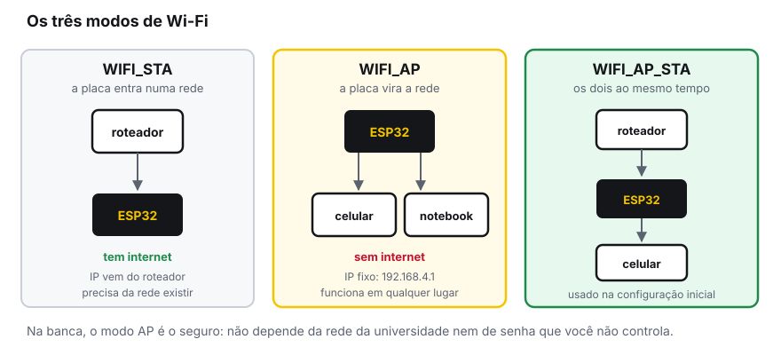
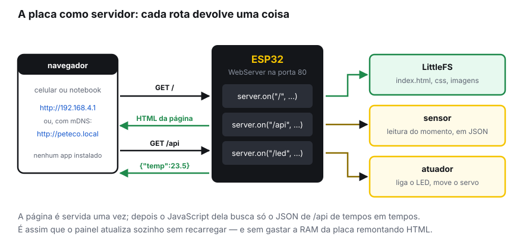
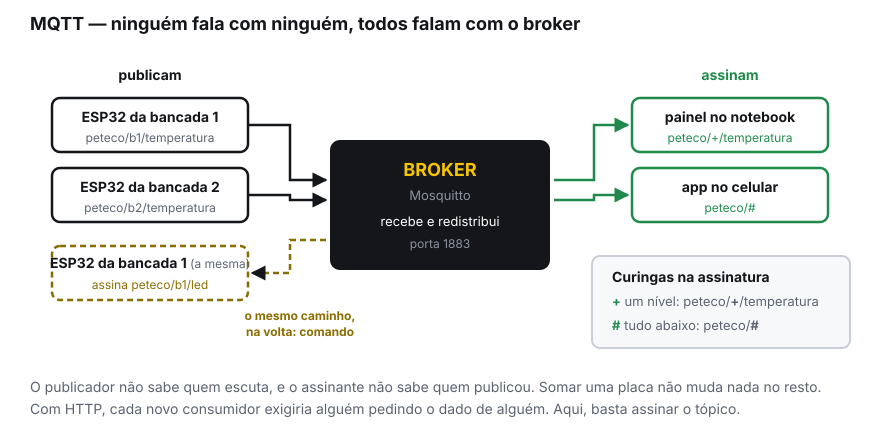
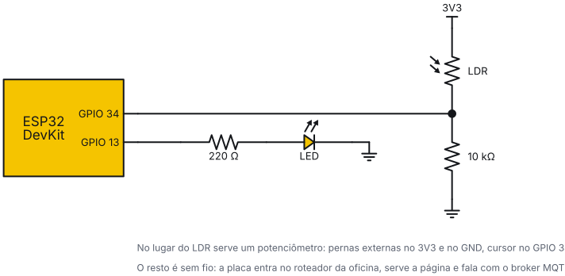

<!-- _class: lead -->
<!-- _header: '' -->
<!-- _footer: '' -->
<!-- _paginate: false -->

# Oficina de ESP32

## 04 — Wi-Fi e IoT

### PETECO — PET Engenharia de Computação
### Universidade Tecnológica Federal do Paraná


---

<!-- _class: center -->

## Onde paramos

Na oficina 3: tasks, filas, persistência em flash e deep sleep.

Hoje a placa deixa de ser uma ilha. No fim da aula, o dado que ela lê aparece **no seu celular**.

> Esta é a oficina que mais depende de infraestrutura. Antes de qualquer código: conecte-se ao roteador que trouxemos, não ao eduroam.

---

<!-- _class: section -->

#### Bloco 1

# Wi-Fi

## Entrar numa rede, ou virar uma

---

## Os três modos



---

<!-- _class: tight -->

## Conectando como estação

```cpp
#include <WiFi.h>

const char *SSID  = "PETECO-Oficina";
const char *SENHA = "esp32peteco";

void setup() {
  Serial.begin(115200);
  WiFi.mode(WIFI_STA);
  WiFi.begin(SSID, SENHA);

  while (WiFi.status() != WL_CONNECTED) { delay(300); Serial.print("."); }

  Serial.printf("\nIP: %s  (RSSI %d dBm)\n",
                WiFi.localIP().toString().c_str(), WiFi.RSSI());
}
```

> **Anote o IP que aparecer.** É por ele que você vai acessar a placa pelo navegador.

---

<!-- _class: tight -->

## O que deve aparecer

Saída típica do `exemplos/04a-wifi-conexao`, que já usa os eventos do próximo slide (IP e RSSI variam):

```text
=== Wi-Fi ===
conectando em "PETECO-Oficina"...
.
conectado!  IP: 192.168.1.147   RSSI: -52 dBm
gateway: 192.168.1.1   mascara: 255.255.255.0
ok  |  IP 192.168.1.147  |  RSSI -52 dBm  |  uptime 4s
```

Desligando o roteador por alguns segundos:

```text
caiu! motivo 200 - tentando de novo
caiu! motivo 201 - tentando de novo
conectado!  IP: 192.168.1.147   RSSI: -51 dBm
```

> Motivo 200 ou 201: o roteador sumiu. Motivo 15 ou 202 logo de cara: senha errada.

---

<!-- _class: alert tight -->

## Por que não o eduroam

O eduroam usa **WPA2-Enterprise**, com usuário, senha e certificado — e não a senha única que o `WiFi.begin(ssid, senha)` espera.

Dá para fazer, com `esp_eap_client_*` e `esp_wifi_sta_enterprise_enable()`, mas é frágil: a combinação de versão do core e configuração de PSRAM já causou **reinício em laço**, e o comportamento muda entre versões.

As três saídas práticas:

- **Roteador próprio** — o que vamos usar hoje
- **Hotspot do celular** — o plano B da banca
- **Modo AP** — a placa cria a própria rede

> Decida isso **antes** da apresentação. Descobrir na hora que a rede da sala não serve é um jeito ruim de perder nota.

---

<!-- _class: tight -->

## Eventos: reagir em vez de esperar

O laço `while (WiFi.status() != WL_CONNECTED)` trava o programa. Em um projeto de verdade, você registra uma função e segue a vida.

```cpp
void aoCair(WiFiEvent_t ev, WiFiEventInfo_t info) {
  Serial.printf("caiu (motivo %d)\n", info.wifi_sta_disconnected.reason);
  WiFi.reconnect();
}

void setup() {
  WiFi.onEvent(aoCair,   ARDUINO_EVENT_WIFI_STA_DISCONNECTED);
  WiFi.onEvent(aoObterIP, ARDUINO_EVENT_WIFI_STA_GOT_IP);
  WiFi.begin(SSID, SENHA);       // não espera: o evento avisa
}
```

> Os nomes mudaram no core 3.x: hoje são `ARDUINO_EVENT_*`. Tutorial com `SYSTEM_EVENT_*` é da versão 2.x e não compila.

---

<!-- _class: alert -->

## Onde esse callback roda

Direto da documentação da Espressif, sobre a função de evento:

> *"WARNING: This function is called from a separate FreeRTOS task (thread)!"*

Lembra da oficina 3? Vale tudo o que vimos lá:

- Variável compartilhada com o `loop()` precisa de **cuidado de concorrência**
- Não faça trabalho pesado ali dentro: levante uma flag ou mande para uma **fila**
- Se o callback e o `loop()` usarem o mesmo barramento I2C ou o display, **mutex**

> Não é uma ISR — aqui você *pode* usar `Serial.print`. Mas é outra thread, e as regras de concorrência valem igual.

---

<!-- _class: tight -->

## Modo AP: a placa vira o roteador

```cpp
WiFi.mode(WIFI_AP);
WiFi.softAP("PETECO-Projeto", "12345678");   // senha: mínimo 8 caracteres

Serial.print("IP do AP: ");
Serial.println(WiFi.softAPIP());             // quase sempre 192.168.4.1
```

- Não precisa de roteador, senha de ninguém nem internet
- O IP é **fixo e previsível**: `192.168.4.1`
- Suporta poucos clientes ao mesmo tempo (uns 4 na prática)

**O padrão usado em produto de verdade:** na primeira ligação a placa sobe em modo AP, você conecta pelo celular e informa a rede de casa; ela guarda no `Preferences` e, nos próximos boots, entra direto como estação. A biblioteca **WiFiManager** faz exatamente isso pronto.

---

<!-- _class: section -->

#### Bloco 2

# Servidor web

## Um painel de controle sem instalar nada

---

## Como funciona



---

<!-- _class: tight -->

## O servidor mais simples que funciona

```cpp
#include <WebServer.h>
WebServer server(80);

void setup() {
  // ... conecta o Wi-Fi ...
  server.on("/", []() {
    server.send(200, "text/html", "<h1>PETECO</h1><p>funcionando</p>");
  });
  server.onNotFound([]() { server.send(404, "text/plain", "nao achei"); });
  server.begin();
}

void loop() {
  server.handleClient();      // sem esta linha, nada responde
}
```

Versão completa, com `/api` e o botão do LED: `exemplos/04b-servidor-web`

---

<!-- _class: alert -->

## Três coisas que derrubam o servidor

**1. Esquecer o `server.handleClient()`** no `loop()`. O servidor sobe, o navegador tenta, e a página nunca carrega.

**2. Montar HTML grande com `String`.** Concatenar `String` fragmenta a memória e, depois de algumas horas, a placa reinicia. Para páginas maiores, sirva do **LittleFS**.

**3. Bloquear o `loop()`.** Qualquer `delay()` longo trava o servidor junto. É mais um motivo para o que vimos na oficina 3: ponha o trabalho pesado em outra task.

> Se a página carrega no notebook mas não no celular: quase sempre é o celular estando noutra rede, ou em dados móveis.

---

<!-- _class: tight -->

## Servindo a página do LittleFS

Em vez de HTML no meio do código, um arquivo de verdade — editável no editor, com destaque de sintaxe e sem escapar aspas.

```cpp
#include <LittleFS.h>

void setup() {
  LittleFS.begin(true);
  server.serveStatic("/", LittleFS, "/index.html");
  server.serveStatic("/estilo.css", LittleFS, "/estilo.css");
  server.begin();
}
```

Para enviar os arquivos à placa, use o plugin **LittleFS Upload** (ou **ESP32 Sketch Data Upload**): crie uma pasta `data/` ao lado do `.ino`, ponha os arquivos ali e mande gravar.

> Lembre da oficina 3: sem um *Partition Scheme* com SPIFFS, o LittleFS nem monta.

---

<!-- _class: tight -->

## A rota que importa: JSON

A página é servida **uma vez**. Depois, o JavaScript dela busca só os números.

```cpp
server.on("/api", []() {
  String json = "{\"temperatura\":" + String(temperatura, 1) +
                ",\"uptime\":"     + String(millis() / 1000) + "}";
  server.send(200, "application/json", json);
});
```

E dentro do `index.html`, no navegador:

```js
setInterval(async () => {
  const d = await (await fetch('/api')).json();
  document.getElementById('temp').textContent = d.temperatura + ' °C';
}, 1000);
```

---

<!-- _class: tight -->

## mDNS: acessar por nome

Decorar `192.168.1.147` é ruim — e o IP muda quando o roteador reinicia.

```cpp
#include <ESPmDNS.h>

if (MDNS.begin("peteco")) {          // vira http://peteco.local
  MDNS.addService("http", "tcp", 80);
  Serial.println("acesse http://peteco.local");
}
```

- Funciona de imediato em **macOS, iOS e Linux**
- No **Windows** costuma funcionar com o Bonjour instalado (vem com o iTunes); sem ele, use o IP
- No **Android** o suporte é irregular: teste antes de prometer isso na banca

> Vale usar os dois: anuncie o `.local` e deixe o IP aparecendo no display, como plano B.

---

<!-- _class: tight -->

## `WebServer` ou `ESPAsyncWebServer`?

| | `WebServer` (built-in) | `ESPAsyncWebServer` |
|---|---|---|
| Instalação | já vem no core | biblioteca externa |
| Como roda | você chama `handleClient()` no `loop()` | em background, sem `loop()` |
| Clientes ao mesmo tempo | um de cada vez | vários |
| WebSocket | não | sim |
| Estabilidade | muito previsível | depende da versão do core |

**Comece pelo `WebServer`.** Ele é suficiente para um painel de projeto e não traz surpresa de compatibilidade.

> O `ESPAsyncWebServer` é ótimo, mas é mantido fora da Espressif e já quebrou em atualizações do core. Se for usar, **teste logo** — não na véspera da entrega.

---

<!-- _class: section -->

#### Bloco 3

# Cliente HTTP

## Quando a placa é quem pergunta

---

<!-- _class: tight -->

## Consumindo uma API

```cpp
#include <HTTPClient.h>
#include <ArduinoJson.h>

void buscaPrevisao() {
  if (WiFi.status() != WL_CONNECTED) return;

  HTTPClient http;
  http.begin("http://api.exemplo.com/clima?cidade=curitiba");
  http.setTimeout(5000);            // não deixe travar para sempre

  int codigo = http.GET();
  if (codigo == 200) {
    JsonDocument doc;               // ArduinoJson 7
    deserializeJson(doc, http.getStream());
    Serial.printf("temp: %.1f\n", doc["temp"].as<float>());
  }
  http.end();                       // SEMPRE libera a conexão
}
```

---

<!-- _class: alert tight -->

## HTTP, HTTPS e memória

**HTTPS custa caro.** O handshake TLS consome vários kilobytes de RAM e alguns segundos. Com `WiFiClientSecure` você precisa, além disso, do certificado da autoridade:

```cpp
WiFiClientSecure cliente;
cliente.setCACert(certificado_raiz);      // ou, só para teste:
// cliente.setInsecure();                 // NÃO valida nada
```

- `setInsecure()` resolve na bancada, mas aceita qualquer servidor
- Certificado tem **validade**: o que funciona hoje pode falhar em um ano
- Muita API pública só aceita HTTPS. Se o projeto depende disso, teste cedo

> Para falar com o **seu próprio** servidor na rede local, HTTP simples poupa memória.

---

<!-- _class: section -->

#### Bloco 4

# MQTT

## O protocolo que foi feito para isto

---

<!-- _class: tight -->

## O problema do HTTP para sensores

Imagine cinco placas e três painéis querendo ver os dados.

Com HTTP, alguém tem que **perguntar**: cada painel consulta cada placa, de tempos em tempos. São 15 conversas, e o dado chega com o atraso do intervalo de consulta. Pior: para alguém de fora da rede ver, a placa precisaria estar exposta na internet.

Com **MQTT**, cada placa **publica** o que tem, quando tem. Quem quiser, **assina**. Ninguém pergunta nada.

| | HTTP | MQTT |
|---|---|---|
| Quem começa a conversa | o cliente pergunta | o dispositivo publica |
| Vários interessados | uma conexão para cada | assinam o mesmo tópico |
| Tamanho do cabeçalho | centenas de bytes | 2 bytes no mínimo |
| Dispositivo atrás de NAT | precisa ser exposto | conecta de dentro para fora |

---

## Publish / subscribe



---

<!-- _class: tight -->

## Tópicos: organize desde o começo

Tópico é uma string com níveis separados por `/`. Não precisa criar nada no broker: publicar já cria.

```text
peteco/bancada1/temperatura
peteco/bancada1/umidade
peteco/bancada1/led          ← comando, no sentido contrário
peteco/bancada2/temperatura
```

**Duas convenções que salvam o projeto:**

- Comece com algo **só seu** (`peteco/...`). Num broker compartilhado, isso evita colisão
- Separe **o que a placa informa** do **que ela recebe**. Um prefixo `.../estado/` e `.../comando/` já basta

> Tópico é sensível a maiúsculas e **não** aceita curinga ao publicar: `+` e `#` só valem na assinatura.

---

<!-- _class: tight -->

## QoS e retain, sem mistério

**QoS** é a garantia de entrega:

| | Garantia | Quando usar |
|---|---|---|
| **0** | entrega no máximo uma vez; pode perder | leitura que se repete a cada segundo |
| **1** | entrega pelo menos uma vez; pode duplicar | comando, alarme — o padrão seguro |
| **2** | entrega exatamente uma vez | raro; custa duas viagens a mais |

**Retain** manda o broker guardar a última mensagem de um tópico. Quem assinar depois recebe o valor atual **na hora**, em vez de esperar a próxima publicação.

> Painel que abre mostrando "--" por 10 segundos é exatamente o problema que o `retain` resolve.

---

<!-- _class: tight -->

## PubSubClient na prática

Com `WiFiClient wifi;` e `PubSubClient mqtt(wifi);` declarados. Completo em `exemplos/04c-mqtt`:

```cpp
// chamado quando chega mensagem de um tópico assinado
void aoReceber(char *topico, byte *dados, unsigned int tamanho) {
  String msg;
  for (unsigned int i = 0; i < tamanho; i++) msg += (char)dados[i];

  if (String(topico) == "peteco/b1/led") {
    digitalWrite(LED, msg == "1" ? HIGH : LOW);
  }
}

void setup() {
  // ... conecta o Wi-Fi ...
  mqtt.setServer("192.168.1.100", 1883);   // IP do broker
  mqtt.setCallback(aoReceber);
}
```

---

<!-- _class: tight -->

## Conectar, reconectar e publicar

```cpp
void garanteConexao() {
  while (!mqtt.connected()) {
    String id = "esp32-" + String((uint32_t)ESP.getEfuseMac(), HEX);
    if (mqtt.connect(id.c_str())) {
      mqtt.subscribe("peteco/b1/led");     // reassine A CADA reconexão
    } else delay(2000);
  }
}

void loop() {
  if (!mqtt.connected()) garanteConexao();
  mqtt.loop();                             // obrigatório
  static unsigned long ultimo = 0;
  if (millis() - ultimo > 5000) {
    ultimo = millis();
    mqtt.publish("peteco/b1/temp", String(leSensor(), 1).c_str(), true);
  }                                        // true = retain
}
```

---

<!-- _class: alert tight -->

## As armadilhas do PubSubClient

| Sintoma | Causa |
|---|---|
| Conecta e cai sozinho em segundos | Duas placas com o **mesmo client ID**. O broker derruba a antiga — use o MAC no ID |
| Mensagem grande nunca chega | Buffer padrão de **256 bytes**. Use `mqtt.setBufferSize(1024)` |
| Para de receber depois de um tempo | Faltou `mqtt.loop()` sendo chamado com frequência |
| Após cair e voltar, não recebe mais | As assinaturas **não** sobrevivem à reconexão: reassine dentro do `connect()` |
| Conecta no broker público mas não no local | Firewall do notebook bloqueando a porta 1883 |

> O `mqtt.loop()` precisa rodar com frequência. Se o `loop()` tiver trabalho pesado, mova o MQTT para uma **task** — como na oficina 3.

---

<!-- _class: tight -->

## Broker e ferramentas

**Broker** — vamos usar o **Mosquitto**, rodando no notebook do professor.

```bash
# instalar e rodar (Linux). Sem o oficina.conf, o Mosquitto 2.x só aceita o próprio notebook
sudo apt install mosquitto mosquitto-clients
printf 'listener 1883\nallow_anonymous true\n' > oficina.conf
mosquitto -c oficina.conf -v

# publicar e assinar pelo terminal, para testar sem a placa
mosquitto_sub -h localhost -t 'peteco/#' -v
mosquitto_pub -h localhost -t 'peteco/b1/led' -m '1'
```

**Para enxergar o que está acontecendo:**

- **MQTT Explorer** — mostra a árvore de tópicos ao vivo. É a ferramenta de depuração
- **Node-RED** — monta um dashboard arrastando blocos, sem escrever front-end
- **broker.hivemq.com**, porta 1883 — broker público de teste. **É aberto:** qualquer um lê o que você publica, então nada sensível e use um prefixo bem específico

---

<!-- _class: tight -->

## Vendo os tópicos chegarem

No notebook do broker, com o `exemplos/04c-mqtt` rodando na bancada `b1`:

```text
$ mosquitto_sub -h localhost -t 'peteco/#' -v
peteco/b1/status online
peteco/b1/sensor {"valor":2731,"uptime":5}
peteco/b1/sensor {"valor":2744,"uptime":10}
peteco/b1/led 1
peteco/b1/sensor {"valor":1210,"uptime":15}
```

O `peteco/b1/led 1` veio de um `mosquitto_pub` em outro terminal: a placa acendeu o LED. Tire a placa da tomada e, uns 20 s depois, o broker publica sozinho:

```text
peteco/b1/status offline
```

> É o *last will*. O MQTT Explorer projetado mostra as mesmas mensagens, em árvore.

---

<!-- _class: section -->

#### Bloco 5

# Dois serviços que valem a pena

## Hora certa e atualização sem cabo

---

<!-- _class: tight -->

## NTP: data e hora de verdade

O ESP32 não tem relógio de bateria: a cada boot, ele acha que é 1970. Com Wi-Fi, uma linha resolve.

```cpp
// fuso de Curitiba: UTC-3, sem horário de verão
configTime(-3 * 3600, 0, "pool.ntp.org", "a.st1.ntp.br");

struct tm agora;
if (getLocalTime(&agora)) {
  Serial.println(&agora, "%d/%m/%Y %H:%M:%S");
}
```

- Leva alguns segundos: `getLocalTime()` devolve `false` enquanto não sincronizou
- Depois disso o relógio interno segue sozinho, inclusive sem rede
- **Não sobrevive ao deep sleep**: sincronize de novo ao acordar

> Log sem hora certa vale muito menos. Se o projeto grava histórico, não é opcional.

---

<!-- _class: tight -->

## OTA: atualizar sem cabo

Com a placa já montada dentro da caixa, abrir tudo para gravar é doloroso.

```cpp
#include <ArduinoOTA.h>

void setup() {
  // ... conecta o Wi-Fi ...
  ArduinoOTA.setHostname("peteco-projeto");
  ArduinoOTA.setPassword("umasenhaboa");   // sem isso, qualquer um grava
  ArduinoOTA.begin();
}

void loop() { ArduinoOTA.handle(); }       // precisa rodar, como o servidor
```

A placa passa a aparecer como **porta de rede** em *Ferramentas → Porta*.

> Requisito: um *Partition Scheme* "with OTA", que tem **duas partições de aplicação**.

---

<!-- _class: section -->

#### Prática

# Mãos na bancada

## Do sensor ao celular

---

<!-- _class: tight -->

## Roteiro da prática

**Parte A — conectar.** Conecte ao roteador da oficina e imprima o IP e o RSSI. Depois registre os eventos de conexão e queda, e confirme que a placa se recupera quando você desliga o roteador por alguns segundos.

**Parte B — servir.** Suba um `WebServer` com duas rotas: `/` devolvendo uma página simples e `/api` devolvendo a leitura do sensor em JSON. Abra pelo celular.

**Parte C — painel.** Faça a página buscar `/api` a cada segundo e atualizar o valor na tela sem recarregar. Some um botão que chame `/led?estado=1` e acenda o LED.

**Parte D — MQTT.** Publique a leitura em `peteco/<sua-bancada>/sensor` e assine `peteco/<sua-bancada>/led`. Confirme no MQTT Explorer projetado que a sua mensagem está chegando.

**Desafio.** Assine o tópico da **bancada vizinha** e mostre a leitura dela no seu painel, ao lado da sua.

---

## Critério de pronto

Ao fim da oficina, sua bancada deve ter:

1. Uma página servida pelo ESP32 que **abre no celular** e atualiza sozinha
2. Um botão na página que **aciona um atuador** de verdade
3. Leituras aparecendo no **MQTT Explorer** sob o seu tópico
4. Reconexão automática: desligar e religar o roteador **não** exige reiniciar a placa

---

<!-- _class: center -->

## O alvo da Parte C


`exemplos/04b-servidor-web`, aberto no celular

---

<!-- _class: center -->

## A montagem completa



Partes A a D: `exemplos/04a` a `04c` · solução com o desafio: `exemplos/04d-painel-completo` · passo a passo em `exemplos/MONTAGEM.md`

---

<!-- _class: dark -->

## Para levar para o projeto

- **Decida a rede agora.** Roteador, hotspot ou modo AP: cada um muda o código e a montagem da apresentação
- **Nunca deixe credencial fixa no código** que vai para o GitHub. `Preferences` ou WiFiManager resolvem
- **Trate a queda como normal**, não como exceção. Rede cai; o projeto não pode precisar de reset
- **MQTT se o projeto tem vários nós ou um painel.** HTTP se é uma placa e uma página
- **Rede é a parte mais imprevisível da banca.** Tenha um plano B que funcione sem internet nenhuma

---

<!-- _class: tight -->

## Referências

| O quê | Onde |
|---|---|
| API de Wi-Fi do core | `docs.espressif.com/projects/arduino-esp32/en/latest/api/wifi.html` |
| Exemplos de eventos de Wi-Fi | `github.com/espressif/arduino-esp32` → `libraries/WiFi/examples` |
| Migração 2.x → 3.x (nomes dos eventos) | `.../migration_guides/2.x_to_3.0.html` |
| PubSubClient (MQTT) | `pubsubclient.knolleary.net` |
| ArduinoJson 7 | `arduinojson.org` |
| Mosquitto e MQTT Explorer | `mosquitto.org` · `mqtt-explorer.com` |
| Código desta oficina | [github.com/RomuaIdo/esp32-oficina](https://github.com/RomuaIdo/esp32-oficina) |

---

## Na próxima oficina

#### 05 — ESP-NOW, BLE e integração

- **ESP-NOW** — placas conversando direto, sem roteador nenhum
- **BLE** — configurar e ler o projeto pelo celular, sem Wi-Fi
- **Arquiteturas** — quando escolher cada tecnologia
- **Prática final** — as 12 placas da turma numa rede só

> É a última da série, e a mais divertida. O fechamento é discutir a arquitetura dos projetos.

---

<!-- _class: end -->
<!-- _header: '' -->
<!-- _footer: '' -->

# Obrigado!

## Dúvidas, agora ou depois

[utfpr.curitiba.br/peteco](https://utfpr.curitiba.br/peteco/) · [@peteco_utfpr](https://www.instagram.com/peteco_utfpr/) · [YouTube](https://www.youtube.com/c/PETECOUTFPR)

**PETECO — PET Engenharia de Computação, UTFPR**
