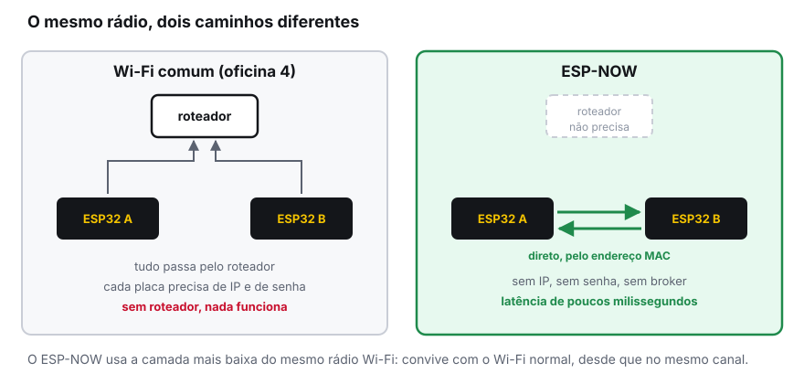
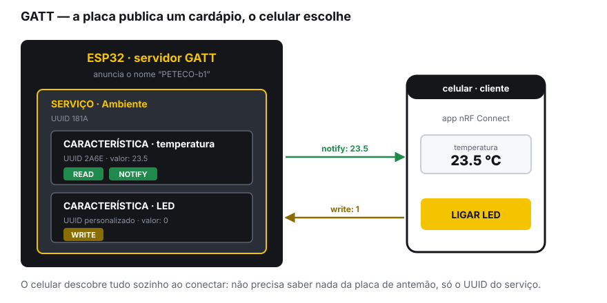
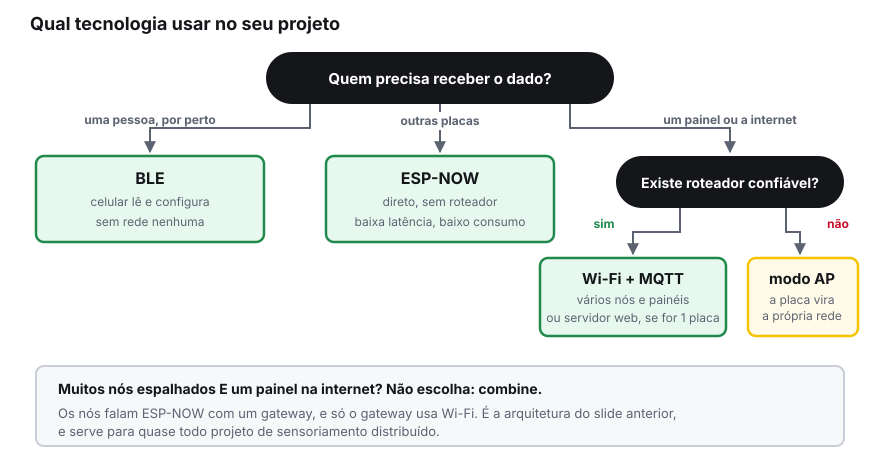
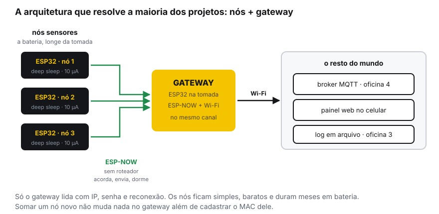
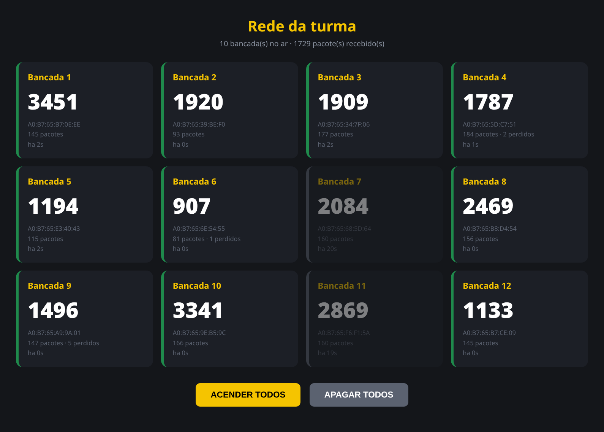
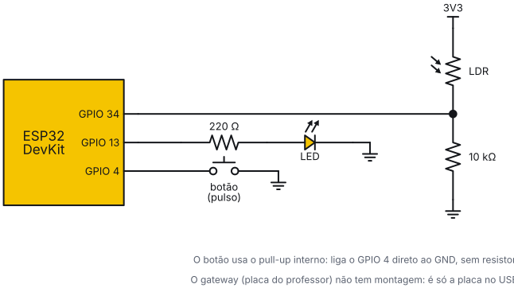

<!-- _class: lead -->
<!-- _header: '' -->
<!-- _footer: '' -->
<!-- _paginate: false -->

# Oficina de ESP32

## 05 — ESP-NOW, BLE e integração

### PETECO — PET Engenharia de Computação
### Universidade Tecnológica Federal do Paraná


---

<!-- _class: center -->

## Onde paramos — e o que fecha hoje

Na oficina 4, a placa passou a falar com o mundo pelo roteador.

Hoje tiramos o roteador do caminho: **placa com placa** (ESP-NOW) e **placa com celular** (BLE). E, no fim, juntamos tudo numa rede com as 12 bancadas da sala.

> Última da série. O fechamento é discutir a arquitetura dos projetos.

---

<!-- _class: section -->

#### Bloco 1

# ESP-NOW

## Duas placas conversando sem nada no meio

---

## O mesmo rádio, outro caminho



---

<!-- _class: tight -->

## O que o ESP-NOW tira da frente

Lembre do que a oficina 4 exigiu para duas placas trocarem um número: um roteador, SSID e senha, um IP para cada, um broker, e tratamento de reconexão.

O ESP-NOW dispensa tudo isso. Uma placa manda para o **endereço MAC** da outra e pronto.

| | O que significa na prática |
|---|---|
| **Sem IP, sem senha** | nada para configurar, nada para cair |
| **Latência de poucos ms** | serve para controle, não só para telemetria |
| **Alcance maior que o Wi-Fi comum** | centenas de metros em campo aberto |
| **Consumo baixo** | acorda, envia em milissegundos, volta a dormir |
| **Até 250 bytes por pacote** | é mensagem curta, não transferência de arquivo |
| **Até 20 pares cadastrados** | (sem criptografia; com ela, menos) |

---

<!-- _class: tight -->

## Primeiro passo: descobrir o MAC

O ESP-NOW endereça pelo MAC, então grave isto em cada placa e anote o resultado:

```cpp
#include <WiFi.h>

void setup() {
  Serial.begin(115200);
  delay(500);
  WiFi.mode(WIFI_STA);                 // precisa estar em STA para ter MAC
  Serial.print("MAC desta placa: ");
  Serial.println(WiFi.macAddress());   // ex.: A0:B7:65:1C:2D:EF
}
```

> O MAC é de fábrica e **não muda**. Cole uma etiqueta em cada placa: vocês vão consultar isso o tempo todo.

---

<!-- _class: center -->

## O que anotar

Saída do `exemplos/05a-descobre-mac` (o MAC muda de placa para placa):

```text
========================================
MAC (copie para o codigo): A0:B7:65:1C:2D:EF
Formato C: {0xA0, 0xB7, 0x65, 0x1C, 0x2D, 0xEF}
Canal atual: 1
========================================
```

A linha `Formato C` já é o array que vai no código do emissor.

---

<!-- _class: tight -->

## Emissor: enviar uma struct

Não mande texto: mande a struct direto. É mais rápido, mais curto e dispensa conversão dos dois lados.

```cpp
uint8_t macDestino[] = {0xA0, 0xB7, 0x65, 0x1C, 0x2D, 0xEF};
struct Pacote { uint8_t bancada; float temperatura; uint32_t contador; };
Pacote dados;

void setup() {
  WiFi.mode(WIFI_STA);
  esp_now_init();

  esp_now_peer_info_t par = {};        // zera a struct inteira
  memcpy(par.peer_addr, macDestino, 6);
  par.channel = 0;                     // 0 = usa o canal atual
  par.encrypt = false;
  esp_now_add_peer(&par);
}
```

---

<!-- _class: tight -->

## Emissor: o envio

```cpp
void loop() {
  dados.bancada     = 1;
  dados.temperatura = leSensor();
  dados.contador++;

  esp_now_send(macDestino, (uint8_t *)&dados, sizeof(dados));
  delay(2000);
}

// Chamado depois que o rádio tentou transmitir (assinatura do core 3.3+).
void aoEnviar(const esp_now_send_info_t *info, esp_now_send_status_t status) {
  Serial.println(status == ESP_NOW_SEND_SUCCESS ? "entregue" : "sem resposta");
}
```

> `esp_now_send` devolver `ESP_OK` diz só que **entrou na fila**. Quem confirma a entrega é o callback — registre com `esp_now_register_send_cb(aoEnviar)`.

---

<!-- _class: tight -->

## Receptor

Com a **mesma** struct `Pacote` declarada dos dois lados:

```cpp
Pacote recebido;

void aoReceber(const esp_now_recv_info_t *info, const uint8_t *dados, int len) {
  memcpy(&recebido, dados, sizeof(recebido));
  Serial.printf("de %02X:%02X  bancada %u: %.1f C\n", info->src_addr[4],
                info->src_addr[5], recebido.bancada, recebido.temperatura);
}

void setup() {
  WiFi.mode(WIFI_STA);
  esp_now_init();
  esp_now_register_recv_cb(aoReceber);
}
```

> Quem **recebe** não precisa de `esp_now_add_peer`: só quem envia.

---

<!-- _class: alert tight -->

## Atenção: as assinaturas dos callbacks mudaram

No core **2.x**, o callback de recepção recebia o MAC direto:

```cpp
void aoReceber(const uint8_t *mac, const uint8_t *dados, int len)
```

No core **3.x** ele recebe uma struct de informações, e o MAC do remetente está dentro dela:

```cpp
void aoReceber(const esp_now_recv_info_t *info, const uint8_t *dados, int len)
//  remetente:  info->src_addr      destinatário:  info->des_addr
```

Quase todo tutorial de ESP-NOW usa a forma antiga. O sintoma é um erro de *invalid conversion* na linha do `esp_now_register_recv_cb`.

> O de **envio** mudou depois, no core **3.3**: era `(const uint8_t *mac, ...)` e hoje é `(const esp_now_send_info_t *info, ...)`, com o destino em `info->des_addr`. O `exemplos/05b-espnow-no` compila nas duas versões.

---

<!-- _class: tight -->

## Broadcast: falar com todo mundo

Para mandar a todas as placas ao alcance, sem cadastrar ninguém, use o MAC de broadcast:

```cpp
uint8_t BROADCAST[] = {0xFF, 0xFF, 0xFF, 0xFF, 0xFF, 0xFF};

esp_now_peer_info_t par = {};
memcpy(par.peer_addr, BROADCAST, 6);
par.channel = 0;
par.encrypt = false;                 // broadcast NÃO aceita criptografia
esp_now_add_peer(&par);

esp_now_send(BROADCAST, (uint8_t *)&dados, sizeof(dados));
```

- Útil para **descoberta**: a placa se anuncia e o gateway a cadastra
- Não há confirmação de entrega: o callback de envio sempre reporta sucesso
- Todo mundo recebe tudo, então filtre pelo conteúdo do pacote

---

<!-- _class: alert tight -->

## A armadilha número um: o canal

ESP-NOW e Wi-Fi compartilham o mesmo rádio, e o rádio só escuta **um canal por vez**.

Se a placa está conectada a um roteador, ela está no canal daquele roteador. Uma placa que não está conectada fica no canal 1 por padrão. **Se os canais não baterem, as mensagens simplesmente não chegam** — sem erro, sem aviso.

As duas situações:

- **Só ESP-NOW**, nenhuma placa no Wi-Fi: todas no mesmo canal (o padrão já resolve)
- **Gateway no Wi-Fi + nós em ESP-NOW**: os nós precisam usar o canal **do roteador**. Descubra com `WiFi.channel()` no gateway e fixe nos nós com `esp_wifi_set_channel()`

> É a causa de 90% dos "não recebo nada" — e o diagnóstico é difícil porque tudo parece certo no código.

---

<!-- _class: section -->

#### Bloco 2

# BLE

## A placa conversando direto com o celular

---

<!-- _class: tight -->

## BLE não é o Bluetooth do fone de ouvido

| | Bluetooth Classic | BLE (Low Energy) |
|---|---|---|
| Para quê | áudio, fluxo contínuo de dados | trocas curtas e esporádicas |
| Consumo | alto | muito baixo |
| Modelo | porta serial (SPP) | banco de dados (GATT) |
| Celular moderno | só alguns perfis | suporte completo |
| No ESP32 | só no ESP32 clássico | em toda a família |

**Quando o BLE ganha do Wi-Fi:** configurar a placa pelo celular sem rede nenhuma; projeto vestível ou a bateria; mostrar a leitura para quem está por perto, sem infraestrutura.

> Se precisa mandar áudio ou fluxo contínuo, BLE não é o caminho.

---

## GATT: serviços e características



---

<!-- _class: tight -->

## O vocabulário, em três linhas

- **Serviço** — um agrupamento, como "Ambiente" ou "Controle"
- **Característica** — um valor dentro do serviço, como "temperatura"
- **UUID** — o identificador de cada um deles

Cada característica tem **propriedades**, que dizem o que o celular pode fazer com ela:

| Propriedade | O celular pode |
|---|---|
| `READ` | ler o valor quando quiser |
| `WRITE` | escrever um valor (um comando) |
| `NOTIFY` | receber avisos quando o valor muda, sem ficar perguntando |

UUIDs curtos como `2A6E` são **padronizados** pela Bluetooth SIG — qualquer app sabe que é temperatura. Para algo seu, gere um UUID de 128 bits em `uuidgen` ou num gerador online.

---

<!-- _class: tight -->

## NimBLE, não a biblioteca padrão

A pilha Bluedroid do core funciona, mas ocupa muita flash e RAM. A **NimBLE-Arduino** (Library Manager, de h2zero) faz o mesmo gastando bem menos.

```cpp
#include <NimBLEDevice.h>

#define UUID_SERVICO "181A"            // Environmental Sensing
#define UUID_TEMP    "2A6E"

void setup() {
  NimBLEDevice::init("PETECO-b1");     // nome que aparece no celular

  NimBLEServer *servidor = NimBLEDevice::createServer();
  NimBLEService *servico = servidor->createService(UUID_SERVICO);
  NimBLECharacteristic *temp = servico->createCharacteristic(
      UUID_TEMP, NIMBLE_PROPERTY::READ | NIMBLE_PROPERTY::NOTIFY);

  servico->start();
}
```

---

<!-- _class: tight -->

## Anunciar e notificar

```cpp
  NimBLEAdvertising *anuncio = NimBLEDevice::getAdvertising();
  anuncio->setName("PETECO-b1");            // no 2.x, o nome NÃO vai sozinho
  anuncio->addServiceUUID(UUID_SERVICO);
  anuncio->enableScanResponse(true);
  servidor->advertiseOnDisconnect(true);    // volta a anunciar ao desconectar
  NimBLEDevice::startAdvertising();
}

void loop() {
  int16_t centesimos = leTemperatura() * 100;   // 2A6E usa centésimos de grau
  temp->setValue((uint8_t *)&centesimos, 2);
  temp->notify();                               // empurra para quem assinou
  delay(1000);
}
```

> `setValue` só guarda o valor. Quem **avisa** o celular é o `notify()`.

---

<!-- _class: tight -->

## Receber comando do celular

```cpp
class CallbacksLed : public NimBLECharacteristicCallbacks {
  void onWrite(NimBLECharacteristic *c, NimBLEConnInfo &info) override {
    std::string valor = c->getValue();
    if (!valor.empty()) {
      digitalWrite(PINO_LED, valor[0] == '1' ? HIGH : LOW);
      Serial.printf("celular mandou: %s\n", valor.c_str());
    }
  }
};

NimBLECharacteristic *led = servico->createCharacteristic(
    UUID_LED, NIMBLE_PROPERTY::READ | NIMBLE_PROPERTY::WRITE);
led->setCallbacks(new CallbacksLed());
```

> O `onWrite` roda na task do BLE, não no `loop()`. Vale o mesmo da oficina 3: nada pesado aqui dentro, e cuidado com recurso compartilhado.

---

<!-- _class: alert tight -->

## NimBLE 2.x mudou várias coisas

Se vocês acharem um exemplo que não compila, é quase certo que foi escrito para a versão 1.x:

| 1.x | 2.x (atual) |
|---|---|
| `onWrite(NimBLECharacteristic *c)` | `onWrite(NimBLECharacteristic *c, NimBLEConnInfo &info)` |
| `onConnect(NimBLEServer *s)` | `onConnect(NimBLEServer *s, NimBLEConnInfo &info)` |
| `setScanResponse(true)` | `enableScanResponse(true)` |
| anunciava o nome sozinho | é preciso chamar `setName()` |
| voltava a anunciar sozinho | é preciso `advertiseOnDisconnect(true)` |
| `setPower(ESP_PWR_LVL_P9)` | `setPower(9)` — em dBm |

> Confira a versão instalada no Library Manager antes de copiar qualquer exemplo da internet.

---

<!-- _class: tight -->

## Testando pelo celular

<div class="cols"><div>

No **nRF Connect**, com o `exemplos/05c-ble-servidor` rodando:

1. *Scan* → **PETECO-b1** → *Connect*
2. Abra **Environmental Sensing**: a característica **Temperature** mostra o valor em °C
3. Toque nas três setas para **assinar** o notify: o valor passa a mudar sozinho
4. Na característica do LED, toque na seta para cima, escolha **Text** e mande `1`

</div><div>

O que aparece no monitor serial:

```text
anunciando como "PETECO-b1"
celular conectado
notify: 27.31
notify: 27.44
celular escreveu: LED ligado
celular desconectado (motivo 531)
```

</div></div>

---

<!-- _class: section -->

#### Bloco 3

# Escolher

## Cinco tecnologias, uma decisão

---

<!-- _class: tight -->

## O quadro completo da série

| | Precisa de | Alcance | Consumo | Boa para |
|---|---|---|---|---|
| **Serial / USB** | cabo | — | — | depuração |
| **BLE** | nada | ~10 m | muito baixo | celular por perto, configuração |
| **ESP-NOW** | nada | centenas de m | baixo | placa com placa, controle rápido |
| **Wi-Fi + servidor** | roteador (ou modo AP) | ~30 m | alto | painel acessível pelo navegador |
| **Wi-Fi + MQTT** | roteador e broker | rede toda | alto | vários nós e vários painéis |

Nenhuma é melhor que a outra: a pergunta certa é **quem precisa receber o dado, e com que infraestrutura você pode contar**.

---

## A árvore de decisão



---

## A arquitetura que resolve a maioria



---

<!-- _class: dark tight -->

## Por que essa combinação funciona tão bem

- **Os nós ficam burros e baratos.** Acordam, leem, enviam em alguns milissegundos e voltam a dormir. Sem IP, sem senha, sem reconexão: duram meses numa bateria
- **Só o gateway é complicado.** Um único ponto lida com Wi-Fi, MQTT e queda de rede — e ele está na tomada, então pode gastar energia à vontade
- **Somar um nó é trivial.** Cadastrar um MAC a mais, e nada no resto do sistema muda
- **Degrada bem.** Se o roteador cair, os nós continuam entregando ao gateway; só a saída para a internet para

> Se o projeto de vocês tem mais de uma placa, comece por aqui.

---

<!-- _class: section -->

#### Prática final

# A rede da turma

## As 12 bancadas num sistema só

---

<!-- _class: tight -->

## Roteiro da prática

**Parte A — descobrir.** Grave o sketch do MAC e anote o endereço da sua placa na tabela do quadro. Confira o MAC do **gateway** (a placa do professor), que está anotado lá.

**Parte B — enviar.** Monte o emissor: uma struct com o número da sua bancada, a leitura do sensor e um contador. Envie ao gateway a cada 2 segundos. Confirme no painel projetado que a sua linha apareceu.

**Parte C — receber.** O gateway vai mandar um comando de broadcast de tempos em tempos. Trate a recepção e acenda o LED quando o comando trouxer o número da sua bancada.

**Parte D — de bancada para bancada.** Combine com a bancada vizinha, troquem os MACs e façam o botão de uma acender o LED da outra. Sem roteador, sem broker, sem IP.

**Desafio.** Suba também o servidor BLE e mostre a sua leitura no nRF Connect — a mesma placa falando ESP-NOW e BLE ao mesmo tempo.

---

## Critério de pronto

Ao fim da oficina, sua bancada deve ter:

1. A sua leitura aparecendo no **painel da turma**, identificada pelo número da bancada
2. O LED respondendo a um **comando de broadcast** do gateway
3. Uma troca **direta com a bancada vizinha**, sem nada no meio
4. Entendimento de **qual das cinco tecnologias** o projeto da sua equipe deve usar

---

<!-- _class: center -->

## O painel da turma



`exemplos/05d-gateway-turma` projetado: os cartões apagados pararam de enviar

---

<!-- _class: center -->

## A montagem de cada bancada



Nó: `exemplos/05b-espnow-no` · BLE: `exemplos/05c-ble-servidor` · passo a passo em `exemplos/MONTAGEM.md`

---

<!-- _class: section -->

#### Fechamento

# Cinco oficinas depois

## O que vocês têm agora

---

<!-- _class: tight -->

## A série inteira, em uma página

| | O que ficou |
|---|---|
| **01** | Pinagem sem armadilha, ADC1 para sensor, interrupção com debounce, `millis()` no lugar de `delay()` |
| **02** | PWM por LEDC, timers de hardware, e os protocolos reais: I2C, SPI, UART, 1-Wire — com o scanner I2C como ferramenta de debug |
| **03** | Tasks e filas do FreeRTOS, persistência em flash com Preferences e LittleFS, deep sleep para durar em bateria |
| **04** | Wi-Fi com reconexão, servidor web embarcado, MQTT, NTP e OTA |
| **05** | ESP-NOW entre placas, BLE para o celular, e o critério para escolher entre tudo isso |

> Todo o código está no repositório. Ele foi escrito para ser copiado para o projeto de vocês — é para isso que ele existe.

---

<!-- _class: dark tight -->

## Checklist antes de entregar o projeto

- [ ] **Mapa de pinos no papel**, com o sensor analógico no ADC1 e nada nos GPIOs 6–11
- [ ] **Tensão conferida** em cada módulo: 3,3 V ou 5 V, e nível lógico resolvido
- [ ] **Alimentação dos atuadores** fora do regulador da placa
- [ ] **Nenhum `delay()`** no caminho crítico
- [ ] **O que precisa sobreviver** a desligar está em `Preferences` ou `LittleFS`
- [ ] **Credenciais fora do código** que vai para o repositório
- [ ] **Plano B de rede** que funcione sem internet nenhuma
- [ ] **Testado com a caixa fechada** — o sinal cai, às vezes muito

> O item que mais derruba projeto na banca é o último. Teste montado, não na protoboard aberta.

---

<!-- _class: tight -->

## Referências

| O quê | Onde |
|---|---|
| API de ESP-NOW no core | `docs.espressif.com/projects/arduino-esp32/en/latest/api/espnow.html` |
| Exemplos oficiais de ESP-NOW | `github.com/espressif/arduino-esp32` → `libraries/ESP32/examples/ESPNow` |
| NimBLE-Arduino | `github.com/h2zero/NimBLE-Arduino` |
| Migração NimBLE 1.x → 2.x | `h2zero.github.io/NimBLE-Arduino` → *Migration guide* |
| App nRF Connect | Play Store e App Store |
| Código das cinco oficinas | [github.com/RomuaIdo/esp32-oficina](https://github.com/RomuaIdo/esp32-oficina) |

---

<!-- _class: center -->

## Agora é com vocês

O ESP32 que estava na gaveta vira o que o projeto de vocês precisar.

**Dúvida no projeto? Procurem o PETECO.** É para isso que o grupo existe.

> E se alguém quiser ajudar a dar a próxima série de oficinas: apareçam.

---

<!-- _class: end -->
<!-- _header: '' -->
<!-- _footer: '' -->

# Obrigado!

## Foi ótimo ter vocês nas cinco

[utfpr.curitiba.br/peteco](https://utfpr.curitiba.br/peteco/) · [@peteco_utfpr](https://www.instagram.com/peteco_utfpr/) · [YouTube](https://www.youtube.com/c/PETECOUTFPR)

**PETECO — PET Engenharia de Computação, UTFPR**
